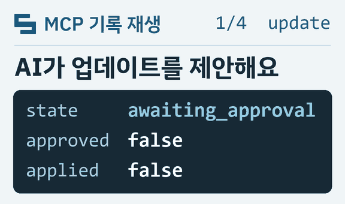

# Shearwater

[English](README.md) · **한국어**

*Human-approved updates for single-node containers.*

**“웹 앱을 새 이미지로 바꾸고, 새 버전이 실제로 응답하는지 확인해 줘.”**

Shearwater는 Linux 서버 한 대에서 작은 웹 앱을 운영하는 오픈소스 도구예요. AI가 변경을 제안하면 사람이 대상과 내용을 보고 그 계획 하나만 승인해요. 대화나 서버가 중간에 끊겨도 같은 작업을 이어가고, 새 앱 사본(Pod)과 내부 접속 주소(Service)에 HTTP 요청을 보내 결과를 확인해요.

[처음 시작하기](#처음-시작하기) · [앱 하나를 AI에게 맡기기](#앱-하나를-ai에게-맡기기) · [측정 결과](#측정-결과)

<p align="center">
  
</p>

**기록 재생** · alpha.12 개발 중 Qwen과 nginx로 진행한 시험의 MCP 요청·응답을 발췌했어요. 이 시험에서는 운영자 역할의 검사 프로그램이 계획을 확인하고 승인했어요. [시험 조건과 결과](docs/agent-operations-verification.md)

<details>
<summary>네 장면을 글로 읽기</summary>

1. AI가 `update`를 요청하자 `awaiting_approval`이 돌아왔어요. `approved`와 `applied`는 모두 `false`였어요.
2. 같은 계획을 승인한 뒤 `verify`로 읽은 상태는 `approved_pending`이었어요. `approved`는 `true`, `applied`는 아직 `false`였어요.
3. 그 사이 AI가 새 `deploy`를 요청했어요. 실행을 기다리는 계획이 있어서 서버가 `409 OperationRejected`로 거절했고, 상태는 `Failure`였어요.
4. `continue`로 원래 계획을 이어간 결과는 `healthy`였어요. 검사한 새 Pod 수(`verifiedPods`)는 1이었고, 내부 Service까지 검사한 결과(`http.state`)는 `passed`였어요.

</details>

## 처음 시작하기

WSL 2의 Ubuntu 24.04(amd64)에서 체험할 수 있어요. 컨테이너를 실행할 containerd·runc, 네트워크 도구와 관리자 권한이 필요해요. [설치 준비물](docs/install.md)

**v0.1.0-alpha.14 다운로드** · [설치기](https://github.com/ChoYugyeong/shearwater/releases/download/v0.1.0-alpha.14/install.py) · [Linux amd64 압축 파일](https://github.com/ChoYugyeong/shearwater/releases/download/v0.1.0-alpha.14/shearwater-v0.1.0-alpha.14-linux-amd64.tar.gz) · [SHA256SUMS](https://github.com/ChoYugyeong/shearwater/releases/download/v0.1.0-alpha.14/SHA256SUMS)

Ubuntu Bash에서 아래 명령을 실행하세요. 빈 임시 폴더에 설치기를 받아 체크섬을 검사해요. 설치기는 압축 파일과 그 안의 `sw`도 검증한 뒤 버전별 폴더에 설치해요.

```bash
(
  set -eu
  version=v0.1.0-alpha.14
  release="https://github.com/ChoYugyeong/shearwater/releases/download/$version"
  download_dir=$(mktemp -d)
  cd "$download_dir"
  curl -fsSLO "$release/install.py"
  curl -fsSLO "$release/SHA256SUMS"
  sha256sum --check --strict --ignore-missing SHA256SUMS
  python3 install.py --version "$version" --apply
  "$HOME/.local/share/shearwater/$version/sw" version
)
```

버전 출력에서 `0.1.0-alpha.14`을 확인하세요. 첫 앱은 `sw setup`으로 인증을 준비한 뒤 예제 nginx의 첫 HTTP 응답까지 따라가면 돼요. [인증 준비](docs/onboarding.md) · [첫 웹 앱 띄우기](docs/first-try.md)

소스에서 빌드하려면 저장소 루트에서 `. hack/env.sh` 다음 `bash hack/build.sh`를 실행하세요. [개발 환경과 빌드 안내](docs/quickstart.md)

## 앱 하나를 AI에게 맡기기

1. **앱과 권한을 정해요.** 운영자가 `sw task create`로 앱 하나, 허용할 동작, 만료 시간을 정해요. AI에는 그 작업의 `work.json`을 연결해요. 외부 AI의 MCP나 내장 Qwen 대화를 쓸 수 있어요.
2. **정확한 계획을 승인해요.** 운영자 터미널의 `sw task review`에서 대상, 변경 전후 이미지, 검사 조건을 읽어요. `sw task approve`에 그 계획의 해시를 지정해야 AI가 적용할 수 있어요.
3. **결과를 확인하고 이어가요.** 서버는 앱 변경과 적용 기록을 SQLite에 함께 저장해요. 모델이 바뀌거나 서버가 재시작돼도 `continue`는 같은 변경을 한 번만 적용해요. 새 Pod 각각과 내부 Service가 HTTP 200 및 지정한 본문 조건을 통과했는지 `sw task evidence`로 확인할 수 있어요.

복구할 때는 이전에 HTTP 검사까지 통과한 이미지로 새 계획을 만들고 다시 승인해요. [위임·승인·복구 명령 예제](docs/agent-operations.md)

## alpha.14에서 새로 생긴 것

- **기존 Docker Compose 앱.** `sw compose serve`를 Compose 프로젝트 앞에 띄우면 서비스 하나를 같은 위임·승인·HTTP 증거 흐름으로 맡길 수 있어요. compose 파일은 고치지 않아요. [Compose 안내](docs/compose-backend.md)
- **공개 HTTPS 진입점.** Service에 `shearwater.io/public-host` 주석을 달고 `sw edge enable`을 켜면 80·443 포트로 내보내요. 인증서는 ACME(HTTP-01)로 받아요. [공개 진입점 안내](docs/public-entry.md)
- **Secret.** 컨테이너가 `env[].valueFrom.secretKeyRef`와 `envFrom[].secretRef`로 값을 읽어요. 값은 base64로 저장할 뿐 암호화하지 않아요.
- **새 서버를 한 번에.** 새 Ubuntu·Debian 서버에서 `sudo python3 install.py --version v0.1.0-alpha.14 --host --apply`를 실행하면, containerd가 없을 때만 containerd·runc를 설치하고 IPv4 전달을 켠 뒤 systemd 서비스를 시작해요. [설치 안내 0절](docs/install.md)

이 기능들은 이 PC의 격리된 시험 환경과 새로 만든 로컬 Ubuntu VM에서 확인했어요. 실제 kubectl, 실제 Docker Compose, ACME 시험용 서버 Pebble을 썼어요. 공인 서버와 실제 Let's Encrypt 인증서로는 아직 확인하지 않았어요. [릴리스 기록](docs/releases.md)

## 측정 결과

같은 Ubuntu 24.04 VM(2 vCPU · 2,560 MiB)에서 같은 nginx 웹 앱을 시험했어요. alpha.12는 앞선 여섯 회의 기준값이에요. alpha.13은 공개 태그에서 새로 빌드한 배포 파일로 다시 쟀어요. alpha.14에서는 다시 재지 않았어요.

| 측정 항목 | 공개 alpha.12 | 공개 alpha.13 |
| --- | ---: | ---: |
| 사본 10개 업데이트 중앙값 (6회) | 22.80초 | **2.83초** |
| 업데이트 중 오류 / 전체 요청 | 0 / 13,762 | **0 / 1,750** |
| 120 Pod 직접 연결 오류 / 전체 요청 (30초 × 2회) | 27,474 / 72,000 | **0 / 72,000** |
| 120 Pod 직접 연결 오류 / 전체 요청 (별도 90초) | 미측정 | **0 / 108,000** |

업데이트 중에는 초당 100개의 새 연결을 보내고, 사본 열 개와 내부 Service가 모두 새 본문을 반환하면 시간을 멈췄어요. alpha.13의 교체 시간이 이 장비에서 87.6% 줄어 구간 내 요청 수도 줄었어요. 밀도 시험에서는 120개 Pod 각각에 초당 10건을 재시도 없이 직접 보냈어요. 120개는 이 시험에서 가장 높은 단계예요. [회차별 결과와 조건](docs/connection-verification.md) · [측정값 CSV](docs/benchmarks/alpha13.csv) · [실행 파일과 체크섬](https://github.com/ChoYugyeong/shearwater/releases/tag/v0.1.0-alpha.13)

### 실제 리소스 사용량

이전 WSL 2 시험(2026-11-11)에서는 BusyBox Pod 10개를 띄우고 60초 동안 유휴 상태를 관찰했어요. `sw server`의 최대 RSS는 34.76 MB, 디스크 쓰기는 0 B였어요. containerd와 앱이 쓰는 자원은 별도예요. [측정 범위와 재현 방법](docs/stage1-verification.md)

## 어떤 환경에 맞나요?

관리자 한 명이 신뢰하는 작은 HTTP 앱을 맡기는 **실험적 알파**예요. 단일 노드·IPv4·TCP ClusterIP를 지원해요. 선택 기능인 공개 진입점이 주석을 단 Service의 TLS를 맡지만, 공개 도메인 연결과 로그인은 따로 확인해야 하고, 이미지 복구에는 DB 데이터 복원이 포함되지 않아요. `securityContext`는 저장만 하며 다중 사용자 격리와 RBAC는 지원 범위 밖이에요. [호환표](docs/compatibility.md)

단일 서버에서 앱 몇 개를 빌드하고 실행하려면 Docker Compose도 좋은 선택이에요. 여러 노드, Ingress, PVC, Helm이 필요하면 Kubernetes나 K3s를 살펴보세요. [도구별 용도 비교](docs/choosing-shearwater.md)

[문제 진단하기](docs/troubleshooting.md) · [체험 결과 남기기](docs/first-try-feedback.md) · [기여하기](CONTRIBUTING.md) · [보안 제보](SECURITY.md) · [Apache 2.0 라이선스](LICENSE) · [출처 고지](NOTICE)
