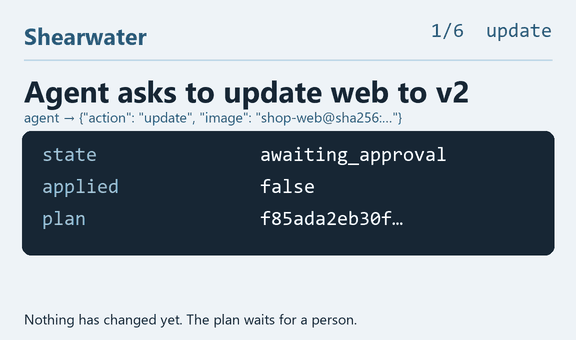

# Shearwater

**English** · [한국어](README.ko.md)

*A Docker Compose server whose deploys an AI agent may run — but never report "done" without HTTP evidence.*

AI agents can change servers through MCP, but giving an agent the Docker socket or a platform API key leaves you guessing what changed and whether it actually works. Shearwater sits between the agent and your Linux server — in front of an **existing Docker Compose project** (no root, your compose files stay untouched) or with **its own small runtime** that speaks a slice of the Kubernetes API.

**What an AI agent (and its operator) gets:**
- **Own limited identity + MCP setup in one command:** `sw agent add` issues a namespace-scoped kubeconfig, agent token (never the admin token), Claude/Codex/Gemini/Qwen MCP config, ops skill, and `AGENT.md` (own runtime).
- **Exact plan-hash approval, executed once:** the agent proposes a plan; you approve its exact hash (`sw task approve`), saved in SQLite with the change so retries, model switches, or restarts never apply it twice.
- **HTTP evidence before "done":** every new replica and the Service/host port must return HTTP 200 and the expected text before the server reports `healthy` — otherwise `http_failed` with stored proof (`sw task evidence`).
- **App leases between agents:** a saved plan holds a lease (`shearwater-app-<app>`) with holder, intent, and expiry; another agent gets `APP_LEASED retry=safe` instead of colliding mid-rollout (`sw lease`).
- **Automatic return to the last verified image:** with `--auto-recover`, a confirmed verification failure on an approved update returns once to the last HTTP-verified immutable image and verifies the recovery.
- **"What changed since revision N and who did it":** `sw changes --since N` and MCP `sw_changes` return bounded field diffs (never Secret values), the actor (a person, an agent, a node or a task), and folded status/heartbeat counts (own runtime).
- **Errors that say whether to retry:** structured `CODE retry=safe|unsafe|never` + hint so agents know when to retry, inspect first, or stop.

[Quick start with Docker Compose](#quick-start-existing-docker-compose-app) · [Own runtime](#quick-start-own-runtime) · [Added after alpha.16](#added-after-alpha16-not-released-yet) · [Benchmarks](#benchmarks)

<p align="center">
  
</p>

<details>
<summary>What the demo shows, as text</summary>

Recorded on a fresh GitHub-hosted VM by the [quick start check](hack/compose-quickstart-check.py), which follows the steps below with a scripted MCP agent; every value on the frames comes from that run's transcript. [Workflow](.github/workflows/compose-quickstart.yml)

1. The agent asks to update `web` to v2. The server saves a plan and returns `awaiting_approval`; nothing has changed.
2. The operator approves that plan's hash with `sw task approve`.
3. The agent calls `continue`. v2 is applied and every new container returns HTTP 200 with the expected text: `healthy`.
4. The next image is approved and applied the same way. It answers HTTP 200, but with a maintenance page instead of the expected text.
5. The server reports `http_failed`, not `healthy`, so the agent cannot report the deploy as done.
6. `recover` plans a return to the last image that passed (v2). After approval it verifies as `healthy`.

An earlier replay of the approval flow against the own runtime is in the [agent operations verification](docs/agent-operations-verification.md).

</details>

### Why not just…

- **…a platform's MCP server (Coolify, Dokploy)?** Those let an agent call the platform's API across your team's apps. Shearwater limits the agent to one app with an expiry, stops at a plan you review by hash, and checks the result before it reports success.
- **…a generic MCP approval proxy?** Those ask a human before a tool call runs. They don't know whether the deploy worked afterwards. Shearwater checks every new replica over HTTP and keeps the evidence.
- **…letting the agent run `docker compose up`?** Then the agent holds the Docker socket, and "it should be running now" is all you get.

## Quick start: existing Docker Compose app

You need a Linux amd64 server with Docker and the `docker compose` plugin, and an operator account in the `docker` group. Root is not required, and Shearwater does not change containerd or your compose files. These steps run on a fresh GitHub-hosted VM whenever they change, using the published release: installing took about 2 s, and the first approved update was verified about 3.5 s after delegation (three runs). [Quick start check](.github/workflows/compose-quickstart.yml)

**1. Install `sw`.** The commands download the installer to an empty temporary directory, verify its checksum, and install this version in its own directory.

```bash
(
  set -eu
  version=v0.1.0-alpha.16
  release="https://github.com/ChoYugyeong/shearwater/releases/download/$version"
  download_dir=$(mktemp -d)
  cd "$download_dir"
  curl -fsSLO "$release/install.py"
  curl -fsSLO "$release/SHA256SUMS"
  sha256sum --check --strict --ignore-missing SHA256SUMS
  python3 install.py --version "$version" --apply
  "$HOME/.local/share/shearwater/$version/sw" version
)
```

The output should start with `sw 0.1.0-alpha.16`. The commands below assume `sw` is on your `PATH`.

**2. Put Shearwater in front of one Compose project.** Keep this running.

```bash
sw compose serve --file /srv/shop/compose.yaml --project shop --listen 127.0.0.1:16444
```

**3. Delegate one service to the agent.** This example allows updates and recovery for the `web` service and requires the response to contain `Welcome`. Running the agent under a separate OS account is recommended, so the handoff folder lives outside your home directory.

```bash
sudo install -d -o "$USER" -m 0755 /srv/sw-handoff   # once
sw task create --config-dir ~/.config/shearwater-compose --listen 127.0.0.1:16444 \
  -n shop --name web --port 80 --allow update,recover --expect-body "Welcome" \
  --out /srv/sw-handoff/web --ttl 2h
```

**4. Connect the agent.** Give the agent's MCP client this command. It gets a token for this one service, never the Docker socket or your operator token.

```bash
sw mcp --workflow=/srv/sw-handoff/web/work.json --allow-write
```

**5. Review and approve what it proposes.** When the agent's plan returns `awaiting_approval`, check it and approve the exact hash from your operator terminal. After the agent continues, read the HTTP evidence.

```bash
sw task review  --config-dir ~/.config/shearwater-compose --listen 127.0.0.1:16444 --id=OPERATION_ID
sw task approve --config-dir ~/.config/shearwater-compose --listen 127.0.0.1:16444 --id=OPERATION_ID --confirm=EXACT_PLAN_HASH
sw task evidence --config-dir ~/.config/shearwater-compose --listen 127.0.0.1:16444 --id=OPERATION_ID
```

Compose recreates the container during an update, so expect a short interruption; use the own runtime below for rolling updates. The full guide covers multiple compose files, separate agent accounts and failure handling. [Compose guide](docs/en/compose-backend.md)

## Quick start: own runtime

Shearwater also ships a small runtime for one server or several (control plane with workers). It speaks a slice of the Kubernetes API (Pods, Deployments, Services, Secrets, RBAC, Ingress, volumes, NetworkPolicy), so `kubectl` works as usual, without importing any `k8s.io` package; CI fails the build if one appears. It adds rolling updates (0 failed requests in the measurements below) and a built-in public HTTPS entry. It needs containerd, runc, networking tools and administrator access. [Installation guide](docs/en/install.md)

On a fresh Ubuntu or Debian server, `sudo python3 install.py --version v0.1.0-alpha.16 --host --apply` installs containerd and runc when none exist and starts the systemd service. Then use `sw setup` to prepare credentials and follow the first-app guide. [Set up credentials](docs/onboarding.md) · [Run your first web app](docs/first-try.md)

**Download v0.1.0-alpha.16** · [Installer](https://github.com/ChoYugyeong/shearwater/releases/download/v0.1.0-alpha.16/install.py) · [Linux amd64 archive](https://github.com/ChoYugyeong/shearwater/releases/download/v0.1.0-alpha.16/shearwater-v0.1.0-alpha.16-linux-amd64.tar.gz) · [SHA256SUMS](https://github.com/ChoYugyeong/shearwater/releases/download/v0.1.0-alpha.16/SHA256SUMS)

To build from source, run `. hack/env.sh` and then `bash hack/build.sh` from the repository root. [Build guide](docs/quickstart.md)

## Delegate an app

1. **Choose the app and permissions.** Use `sw task create` to select one app, the actions the agent may take, and an expiry time. Connect the resulting `work.json` to an external agent through MCP or use Shearwater’s built-in Qwen chat.
2. **Approve the exact change.** Run `sw task review` in your operator terminal to inspect the target, current image, proposed image and verification conditions. Pass the plan’s hash to `sw task approve` to authorize it.
3. **Resume and verify.** Shearwater saves the app change and its execution record together in SQLite. If you switch models or restart the server, `continue` can resume without applying the change twice. Use `sw task evidence` to see whether each new Pod and the internal Service returned HTTP 200 and the expected content.

To recover, create and approve a new plan that uses an image which previously passed HTTP verification (or opt in to `--auto-recover` in the unreleased changes below). [Delegation, approval and recovery examples](docs/en/agent-operations.md)

## Added after alpha.16 (not released yet)

The changes below are on the development branch and are not in the `v0.1.0-alpha.16` download yet.

- **One-command agent identity (`sw agent`).** `sw agent add NAME --namespace NS [--client claude|codex|gemini|qwen|all]` creates a namespace-scoped kubeconfig, an agent-only `sw/` connection folder (never `admin.token`), MCP configs, an embedded copy of `skills/shearwater-ops/`, and `AGENT.md`, and prints the attach command for your client. Namespace-scoped tokens work with read, diagnostic, change-summary, and single-namespace verify/apply MCP tools without falling back to admin credentials. [Agent identity guide](docs/en/agent-identity.md)
- **Who changed what since revision N (`sw changes`, MCP `sw_changes`).** Every attributed write records its actor (`admin`, user/agent name, `system:node:NAME`, `task:ID`) and source (`kubectl`, `api`, `node`, `task`) in the same transaction. `sw changes --since N` and `sw_changes` return compact field diffs (never Secret values), fold status/heartbeat noise, and give a `next` revision cursor.
- **App leases between agents (`sw lease`, `coordination.k8s.io/v1` Lease).** Saving a delegated plan acquires `shearwater-app-<app>` with holder, intent, and expiry (up to 15 minutes). Another task trying to plan on the same app receives `APP_LEASED retry=safe` with the holder, intent, and expiry; operators can inspect or release leases with `sw lease list` / `sw lease release` or `kubectl get leases`. [Agent operations](docs/en/agent-operations.md)
- **Automatic recovery on failed updates (`--auto-recover`).** With `sw task create ... --allow update,recover --auto-recover`, a first confirmed verification failure on an approved update triggers one pre-authorized recovery back to the last HTTP-verified immutable image and verifies it, recording both the original failure and the recovery result in `sw task evidence`.
- **Standby control plane and witness (in progress).** A semi-synchronous SQLite replication log, active/standby + witness protocol, and in-place leader/standby role switching let a two-control-plane cluster keep confirmed writes across a single control-plane failure (CLI wiring and QA failover timing: TBD). [Two control planes guide](docs/en/ha.md)

## Benchmarks

Both versions ran the same nginx app on the same Ubuntu 24.04 VM with 2 vCPUs and 2,560 MiB of memory. The alpha.12 baseline comes from an earlier test series. For alpha.13, the tests used the release binary built from the public tag. These figures were not re-measured for alpha.14, alpha.15 or alpha.16.

| Measurement | alpha.12 | alpha.13 |
| --- | ---: | ---: |
| Median time to update 10 replicas (6 runs) | 22.80 s | **2.83 s** |
| Errors / requests during those updates | 0 / 13,762 | **0 / 1,750** |
| Direct requests to 120 Pods, errors / requests (two 30 s runs) | 27,474 / 72,000 | **0 / 72,000** |
| Direct requests to 120 Pods, errors / requests (separate 90 s run) | Unmeasured | **0 / 108,000** |

During updates, the test opened 100 new connections per second until all 10 replicas and the Service returned the new version’s content. Updates finished 87.6% sooner on this machine, so fewer requests fell inside the update window. In the density test, each Pod received 10 direct requests per second with no retries. The highest count tested was 120 Pods. [Method and per-run results](docs/connection-verification.md) · [Measurements as CSV](docs/benchmarks/alpha13.csv) · [Release binary and checksums](https://github.com/ChoYugyeong/shearwater/releases/tag/v0.1.0-alpha.13)

### Idle resource use

In a separate WSL 2 test on November 11, 2026, the `sw server` process reached 34.76 MB peak resident memory and wrote 0 B to disk over 60 idle seconds with 10 BusyBox Pods present. These figures cover the Shearwater process alone. The container runtime and apps have their own resource costs. [Measurement scope and reproduction steps](docs/stage1-verification.md)

On November 17, 2026, a separate test compared alpha.9 with Docker Compose and K3s on the same machine, running the same app. It recorded memory use, time until a deployment was ready, and failed requests during updates. The three tools cover different feature sets, so the results are not a ranking. [Conditions and results (in Korean)](docs/benchmarks/runtime-comparison-alpha9.md)

The same measurement now runs on GitHub Actions with minikube added (manually and weekly). On November 24, 2026, three repeats on a shared 4-CPU runner measured all four tools, one at a time. [CI comparison and results (in Korean)](docs/benchmarks/runtime-bench-ci.md)

## Where it fits

Shearwater is an **experimental alpha** for running trusted HTTP apps on one server or a few. In the published `v0.1.0-alpha.16` release, it supports IPv4 and TCP ClusterIP Services with one control plane and no high availability (a two-control-plane standby + witness mode is in progress on the development branch; failover timing TBD). Its HTTP checks cover internal endpoints. The optional public entry terminates TLS for annotated Services, but public DNS and login flows need separate checks, and rolling back an image does not restore database contents. Pod Security admission can check `securityContext` fields, but containers run with the runtime's default security settings. RBAC, quotas and NetworkPolicy separate tenants; they have not been hardened against hostile tenants. [Compatibility matrix](docs/compatibility.md)

If you already run a few apps with Docker Compose, keep Compose and put Shearwater in front of it. Consider Kubernetes or K3s if you need a production-proven HA control plane, network storage, Helm or the full Kubernetes API. [Compare use cases](docs/choosing-shearwater.md)

## Release history

### New in alpha.16

- **Several servers.** Start the control plane with `sw up --advertise-address IP`, print the join command with `sw node token`, and run it on each worker (`sw join`). Pods are scheduled across nodes (node selectors, node affinity, taints, requests), reach each other over a VXLAN pod network, and are recreated on other nodes by their controllers when a server stops answering. There is one control plane in alpha.16; it is not highly available yet. [Several servers](docs/en/multi-node.md)
- **Access control for several people and agents.** RBAC with Roles, ClusterRoles and bindings, `kubectl auth can-i` and `whoami`, and `sw user add NAME --namespace NS` for a kubeconfig limited to one namespace; ResourceQuota and Pod Security apply to Pods created directly and through Deployments. [Access control](docs/en/access-control.md)
- **Cluster DNS and Ingress.** `sw` answers `<service>.<namespace>.svc.cluster.local` on every node. Ingress routes hosts and paths through the public entry, and a host stays with the namespace that claimed it first. [DNS](docs/en/dns.md) · [Ingress](docs/en/ingress.md)
- **Persistent volumes and NetworkPolicy.** PersistentVolumeClaims with a built-in `local-path` StorageClass that keeps a Pod on the node holding its data, and NetworkPolicy enforced on every node.

These were checked on three simulated servers (each with its own network namespace, containerd and cgroup) through nine end-to-end steps, including a worker that stops answering. They were not yet checked on separate machines or cloud networks. VXLAN traffic is not encrypted, so use a private network or a VPN. [Release notes](docs/releases.md)

### Added in alpha.15

- **Failed checks say where and why.** When a release fails its HTTP check (`http_failed`), the agent gets which check failed, on how many replicas and why, for example `HTTP 200, expected text missing`. The expected text itself is never repeated. `diagnose` reports the last failed check with its time.
- **Evidence says what it showed.** `sw task evidence` now reports the stored proof's outcome (`passed`/`failed`), when it was taken and for which goal, so a just-verified app is no longer read as unchecked.
- **Steadier certificate renewal for the public entry.** Renewal starts as soon as a certificate enters its renewal window, the previous certificate keeps serving until the renewed one is safely valid, `sw edge status` marks expired certificates, and backups include the entry settings, ACME account key and certificates.
- **Clearer startup and verify output.** `sw up` shows the server's last log line when startup fails, and verify facts name what was actually checked for each backend (Pods and a Service, or containers and a host port).

The failure explanations are checked on a fresh GitHub-hosted VM with real Docker, both with the published release installed the README way and with a build of the current source (the quick start check). The certificate changes were checked against the Pebble ACME test server. [Release notes](docs/releases.md)

### Added in alpha.14

- **Existing Docker Compose apps.** `sw compose serve` puts the same delegation, approval and HTTP evidence in front of one service of a Compose project. Your compose files are not rewritten. [Compose guide](docs/en/compose-backend.md)
- **Public HTTPS entry.** Annotate a Service with `shearwater.io/public-host` and `sw edge enable` serves it on ports 80/443 with ACME (HTTP-01) certificates. [Public entry guide](docs/public-entry.md)
- **Secrets.** Containers can read `env[].valueFrom.secretKeyRef` and `envFrom[].secretRef`. Values are stored base64-encoded, not encrypted.
- **One-command server setup.** On a fresh Ubuntu or Debian server, `sudo python3 install.py --version v0.1.0-alpha.16 --host --apply` installs containerd and runc when none exist, enables IPv4 forwarding and starts the systemd service. [Install guide, section 0](docs/install.md)

The alpha.14 additions were checked in isolated local test environments and a fresh local Ubuntu VM: real kubectl, real Docker Compose, the Pebble ACME test server. They were not yet checked on a public server with real Let's Encrypt certificates. [Release notes](docs/releases.md)

[Troubleshooting](docs/troubleshooting.md) · [First-use feedback](docs/first-try-feedback.md) · [Contributing](CONTRIBUTING.md) · [Report a security issue](SECURITY.md) · [Apache 2.0 license](LICENSE) · [Notices](NOTICE)
