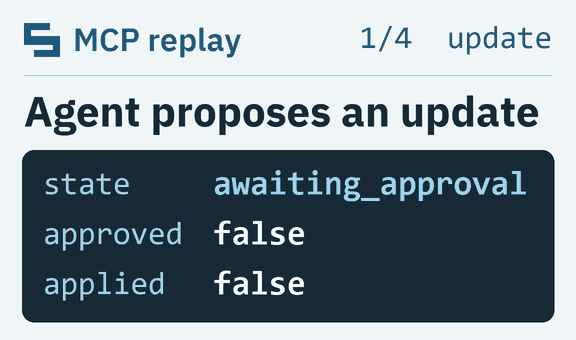

# Shearwater

**English** · [한국어](README.ko.md)

*Let an AI agent deploy to your server — but only the change you approved, exactly once, and not "done" until it actually answers.*

AI agents can now change servers through MCP. Shearwater sits between the agent and one Linux server. The agent may touch only the app you delegated. You approve the exact plan. The plan runs once, even if the model changes or the server restarts. And the agent cannot report success until every new replica returns the response you expected over HTTP.

Put it in front of an **existing Docker Compose project** (no root, your compose files are not rewritten), or run it with **its own small runtime** that speaks a slice of the Kubernetes API.

[Quick start with Docker Compose](#quick-start-existing-docker-compose-app) · [Own runtime](#quick-start-own-runtime) · [Benchmarks](#benchmarks)

<p align="center">
  
</p>

<details>
<summary>What the replay shows, as text</summary>

This replays the Model Context Protocol (MCP) messages from a Qwen test with nginx during alpha.12 development. A test program played the operator and approved the plan. [Test setup and results](docs/agent-operations-verification.md)

1. The agent requests `update`. The server returns `awaiting_approval`, with both `approved` and `applied` set to `false`.
2. After approval, `verify` reports `approved_pending`. The plan is approved and still waiting to run.
3. The agent requests another `deploy`. The server returns HTTP `409` with reason `OperationRejected` because the first plan is pending.
4. The agent calls `continue` on the original plan. The operation reports `healthy`. One new Pod was checked (`verifiedPods: 1`) and HTTP verification passed for the Pod and its internal Service (`http.state: passed`).

</details>

### Why not just…

- **…a platform's MCP server (Coolify, Dokploy)?** Those let an agent call the platform's API across your team's apps. Shearwater limits the agent to one app with an expiry, stops at a plan you review by hash, and checks the result before it reports success.
- **…a generic MCP approval proxy?** Those ask a human before a tool call runs. They don't know whether the deploy worked afterwards. Shearwater checks every new replica over HTTP and keeps the evidence.
- **…letting the agent run `docker compose up`?** Then the agent holds the Docker socket, and "it should be running now" is all you get.

## Quick start: existing Docker Compose app

You need a Linux amd64 server with Docker and the `docker compose` plugin, and an operator account in the `docker` group. Root is not required, and Shearwater does not change containerd or your compose files.

**1. Install `sw`.** The commands download the installer to an empty temporary directory, verify its checksum, and install this version in its own directory.

```bash
(
  set -eu
  version=v0.1.0-alpha.14
  release="https://github.com/ChoYugyeong/shearwater/releases/download/$version"
  download_dir=$(mktemp -d)
  cd "$download_dir"
  curl -fsSLO "$release/install.py"
  curl -fsSLO "$release/SHA256SUMS"
  sha256sum --check --strict --ignore-missing SHA256SUMS
  python3 install.py --version "$version" --apply
  "$HOME/.local/share/shearwater/$version/sw" version
)
```

The output should start with `sw 0.1.0-alpha.14`. The commands below assume `sw` is on your `PATH`.

**2. Put Shearwater in front of one Compose project.** Keep this running.

```bash
sw compose serve --file /srv/shop/compose.yaml --project shop --listen 127.0.0.1:16444
```

**3. Delegate one service to the agent.** This example allows updates and recovery for the `web` service and requires the response to contain `Welcome`. Running the agent under a separate OS account is recommended, so the handoff folder lives outside your home directory.

```bash
sudo install -d -o "$USER" -m 0755 /srv/sw-handoff   # once
sw task create --config-dir ~/.config/shearwater-compose --listen 127.0.0.1:16444 \
  -n shop --name web --port 80 --allow update,recover --expect-body "Welcome" \
  --out /srv/sw-handoff/web --ttl 2h
```

**4. Connect the agent.** Give the agent's MCP client this command. It gets a token for this one service, never the Docker socket or your operator token.

```bash
sw mcp --workflow=/srv/sw-handoff/web/work.json --allow-write
```

**5. Review and approve what it proposes.** When the agent's plan returns `awaiting_approval`, check it and approve the exact hash from your operator terminal. After the agent continues, read the HTTP evidence.

```bash
sw task review  --config-dir ~/.config/shearwater-compose --listen 127.0.0.1:16444 --id=OPERATION_ID
sw task approve --config-dir ~/.config/shearwater-compose --listen 127.0.0.1:16444 --id=OPERATION_ID --confirm=EXACT_PLAN_HASH
sw task evidence --config-dir ~/.config/shearwater-compose --listen 127.0.0.1:16444 --id=OPERATION_ID
```

Compose recreates the container during an update, so expect a short interruption; use the own runtime below for rolling updates. The full guide covers multiple compose files, separate agent accounts and failure handling. [Compose guide](docs/en/compose-backend.md)

## Quick start: own runtime

Shearwater also ships a small single-node runtime. It speaks a slice of the Kubernetes API (Pod, Deployment, Service, Secret), so `kubectl` works as usual, without importing any `k8s.io` package; CI fails the build if one appears. It adds rolling updates (0 failed requests in the measurements below) and a built-in public HTTPS entry. It needs containerd, runc, networking tools and administrator access. [Installation guide](docs/en/install.md)

On a fresh Ubuntu or Debian server, `sudo python3 install.py --version v0.1.0-alpha.14 --host --apply` installs containerd and runc when none exist and starts the systemd service. Then use `sw setup` to prepare credentials and follow the first-app guide. [Set up credentials](docs/onboarding.md) · [Run your first web app](docs/first-try.md)

**Download v0.1.0-alpha.14** · [Installer](https://github.com/ChoYugyeong/shearwater/releases/download/v0.1.0-alpha.14/install.py) · [Linux amd64 archive](https://github.com/ChoYugyeong/shearwater/releases/download/v0.1.0-alpha.14/shearwater-v0.1.0-alpha.14-linux-amd64.tar.gz) · [SHA256SUMS](https://github.com/ChoYugyeong/shearwater/releases/download/v0.1.0-alpha.14/SHA256SUMS)

To build from source, run `. hack/env.sh` and then `bash hack/build.sh` from the repository root. [Build guide](docs/quickstart.md)

## Delegate an app

1. **Choose the app and permissions.** Use `sw task create` to select one app, the actions the agent may take, and an expiry time. Connect the resulting `work.json` to an external agent through MCP or use Shearwater’s built-in Qwen chat.
2. **Approve the exact change.** Run `sw task review` in your operator terminal to inspect the target, current image, proposed image and verification conditions. Pass the plan’s hash to `sw task approve` to authorize it.
3. **Resume and verify.** Shearwater saves the app change and its execution record together in SQLite. If you switch models or restart the server, `continue` can resume without applying the change twice. Use `sw task evidence` to see whether each new Pod and the internal Service returned HTTP 200 and the expected content.

To recover, create and approve a new plan that uses an image which previously passed HTTP verification. [Delegation, approval and recovery examples](docs/en/agent-operations.md)

## New in alpha.14

- **Existing Docker Compose apps.** `sw compose serve` puts the same delegation, approval and HTTP evidence in front of one service of a Compose project. Your compose files are not rewritten. [Compose guide](docs/en/compose-backend.md)
- **Public HTTPS entry.** Annotate a Service with `shearwater.io/public-host` and `sw edge enable` serves it on ports 80/443 with ACME (HTTP-01) certificates. [Public entry guide](docs/public-entry.md)
- **Secrets.** Containers can read `env[].valueFrom.secretKeyRef` and `envFrom[].secretRef`. Values are stored base64-encoded, not encrypted.
- **One-command server setup.** On a fresh Ubuntu or Debian server, `sudo python3 install.py --version v0.1.0-alpha.14 --host --apply` installs containerd and runc when none exist, enables IPv4 forwarding and starts the systemd service. [Install guide, section 0](docs/install.md)

These were checked in isolated local test environments and a fresh local Ubuntu VM: real kubectl, real Docker Compose, the Pebble ACME test server. They were not yet checked on a public server with real Let's Encrypt certificates. [Release notes](docs/releases.md)

## Benchmarks

Both versions ran the same nginx app on the same Ubuntu 24.04 VM with 2 vCPUs and 2,560 MiB of memory. The alpha.12 baseline comes from an earlier test series. For alpha.13, the tests used the release binary built from the public tag. These figures were not re-measured for alpha.14.

| Measurement | alpha.12 | alpha.13 |
| --- | ---: | ---: |
| Median time to update 10 replicas (6 runs) | 22.80 s | **2.83 s** |
| Errors / requests during those updates | 0 / 13,762 | **0 / 1,750** |
| Direct requests to 120 Pods, errors / requests (two 30 s runs) | 27,474 / 72,000 | **0 / 72,000** |
| Direct requests to 120 Pods, errors / requests (separate 90 s run) | Unmeasured | **0 / 108,000** |

During updates, the test opened 100 new connections per second until all 10 replicas and the Service returned the new version’s content. Updates finished 87.6% sooner on this machine, so fewer requests fell inside the update window. In the density test, each Pod received 10 direct requests per second with no retries. The highest count tested was 120 Pods. [Method and per-run results](docs/connection-verification.md) · [Measurements as CSV](docs/benchmarks/alpha13.csv) · [Release binary and checksums](https://github.com/ChoYugyeong/shearwater/releases/tag/v0.1.0-alpha.13)

### Idle resource use

In a separate WSL 2 test on November 11, 2026, the `sw server` process reached 34.76 MB peak resident memory and wrote 0 B to disk over 60 idle seconds with 10 BusyBox Pods present. These figures cover the Shearwater process alone. The container runtime and apps have their own resource costs. [Measurement scope and reproduction steps](docs/stage1-verification.md)

On November 17, 2026, a separate test compared alpha.9 with Docker Compose and K3s on the same machine, running the same app. It recorded memory use, time until a deployment was ready, and failed requests during updates. The three tools cover different feature sets, so the results are not a ranking. [Conditions and results (in Korean)](docs/benchmarks/runtime-comparison-alpha9.md)

The same measurement now runs on GitHub Actions with minikube added (manually and weekly). On November 24, 2026, three repeats on a shared 4-CPU runner measured all four tools, one at a time. [CI comparison and results (in Korean)](docs/benchmarks/runtime-bench-ci.md)

## Where it fits

Shearwater is an **experimental alpha** for one operator running trusted HTTP apps on a single node. It supports IPv4 and TCP ClusterIP Services. Its HTTP checks cover internal endpoints. The optional public entry terminates TLS for annotated Services, but public DNS and login flows need separate checks, and rolling back an image does not restore database contents. Shearwater stores `securityContext` fields without enforcing them. Multi-tenant isolation and Kubernetes RBAC are outside its supported scope. [Compatibility matrix](docs/compatibility.md)

If you already run a few apps with Docker Compose, keep Compose and put Shearwater in front of it. Consider Kubernetes or K3s if you need multiple nodes, Ingress, persistent volume claims or Helm. [Compare use cases](docs/choosing-shearwater.md)

[Troubleshooting](docs/troubleshooting.md) · [First-use feedback](docs/first-try-feedback.md) · [Contributing](CONTRIBUTING.md) · [Report a security issue](SECURITY.md) · [Apache 2.0 license](LICENSE) · [Notices](NOTICE)
