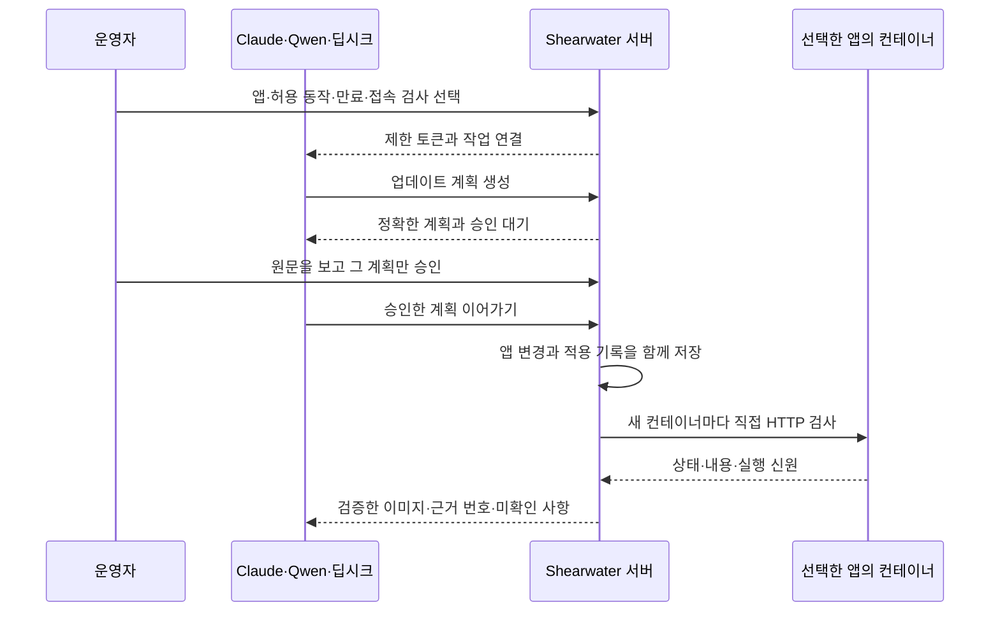

# 앱 하나의 운영을 AI에게 위임하기

[English](en/agent-operations.md) · **한국어**

이 문서는 **alpha.12부터 제공하는** 서버 작업 기능을 설명해. alpha.11에는 `sw task`가 없어.
[설치 안내](install.md)의 예제를 따라 서버와 클라이언트를 모두 alpha.14으로 준비해.
구현은 [internal/operation](../internal/operation), 명령 연결은
[cmd/sw/operation.go](../cmd/sw/operation.go)에 있어.

## 무엇이 달라지나

사용자는 “이 앱을 업데이트하고 실제로 정상인지 확인해 줘”라고 요청해. AI는 작업 종류를
선택하고 결과를 설명해. Shearwater 서버는 **어느 앱인지, 무엇을 허용했는지, 어떤 변경을
승인했는지, 이미 적용했는지, 새 컨테이너가 실제로 응답했는지**를 관리해.

기존 `sw connect`의 로컬 작업 파일도 계속 사용할 수 있어. 그 방식은 관리자 인증을 가진
클라이언트가 앱 선택과 승인 절차를 지켜. 새 `sw task` 방식은 앱에 제한된 별도 토큰을
발급하고 서버에서도 제한을 강제해. 작업 파일을 편집하거나 숨겨진 HTTP 주소를 직접
호출해도 그 토큰으로 다른 앱, 원시 Kubernetes API, 승인·권한 발급 기능을 사용할 수 없어.



| 말 | 쉬운 뜻 |
| --- | --- |
| 작업 ID | 한 앱을 맡긴 기록의 번호. 다른 모델로 바꿔도 같은 번호를 사용해 |
| UID | 앱을 생성할 때 받은 고유 번호. 같은 이름으로 다시 만든 앱은 다른 앱이야 |
| 위임 토큰 | 이 작업의 허용 동작만 정해진 시간까지 수행하는 비밀값 |
| 계획 해시 | 사람이 확인한 변경을 식별하는 값. 다른 변경의 승인을 재사용하지 않아 |
| 세대 | 앱 설정의 버전 번호. 과거 설정의 정상 상태를 새 배포 성공으로 세지 않아 |
| 이미지 digest | 이미지 내용의 고정 지문. 태그 이름은 원격 저장소에서 바뀔 수 있어 |
| 근거 번호 | 실제 HTTP 검사 기록을 찾는 값. AI에게 본문 전체를 보내지 않아도 검토할 수 있어 |

## 처음 연결하기

서버와 일반 사용자용 관리자 인증 준비는 [처음 설치·인증](onboarding.md)을 먼저 봐.
이미 실행할 컨테이너 이미지가 필요해. 이미지 빌드·레지스트리·공개 도메인·HTTPS·DB 이전은
이 기능이 자동으로 준비하지 않아. 서버 한 대의 신뢰하는 작은 HTTP 앱이 대상이야.

**관리자 인증을 가진 운영자 터미널**에서 실행해. 아래 경로·이름·이미지를 자신의 실제 값으로
바꿔. `--out`은 아직 존재하지 않는 절대 경로여야 해. 기존 인증을 덮어쓰지 않아.

```bash
# 기존 앱: 유일하게 연결되는 Service와 TCP 포트는 자동으로 찾는다.
sw task create --name=web -n default \
  --allow=update,recover --ttl=1h \
  --http-path=/health --expect-body=ok \
  --out="$HOME/.local/state/shearwater/agents/web"

# 새 앱: 이름·처음 실행할 이미지·포트를 운영자가 선택한다.
sw task create --name=demo -n default \
  --image=YOUR_REGISTRY/demo@sha256:YOUR_ACTUAL_DIGEST --port=8080 \
  --allow=deploy,update,recover --ttl=1h \
  --out="$HOME/.local/state/shearwater/agents/demo"
```

`--allow`를 생략하면 조회만 허용해. 허용 동작은 `deploy`, `update`, `recover` 중에서 고르고,
만료 시간은 최대 24시간이야. 기존 앱에 여러 Service나 TCP 포트가 있으면
`--service=이름 --port=Service포트`를 명시해. 이름으로 지정한 targetPort도 지원해.
Service가 선택하는 Pod는 실제로 그 앱의 ReplicaSet에 속해야 해.

출력은 작업 ID, 연결 파일 경로, MCP 설정을 알려줘. 새 폴더에는 공개 CA 인증서,
`delegated.token`, `work.json`만 들어가. 관리자 토큰은 복사하지 않아. 토큰 원문은 표준 출력이나
서버 DB에 기록하지 않고, 서버에는 검증용 해시만 저장해.

기존 기본 인증 대신 다른 서버를 지정하려면 `--config-dir=/운영자/인증 --listen=127.0.0.1:포트`를
함께 써. AI에게 이 관리자 인증 폴더를 전달하지 마.

## Claude·Qwen·딥시크가 같은 작업을 쓰기

생성된 `work.json`으로 기존 MCP 또는 내장 대화를 시작해. 앱 이름·UID·포트를 AI가 다시
입력할 필요가 없어. 목록에는 `sw_workflow` 하나와 허용된 동작만 나타나.

```bash
sw mcp --workflow=/absolute/agent/web/work.json --allow-write

sw chat --workflow=/absolute/agent/web/work.json --allow-write --model=qwen2.5:latest

# MCP 설정만 출력한다. AI 앱의 전역 설정을 덮어쓰지 않는다.
sw workflow mcp-config --file=/absolute/agent/web/work.json --platform=linux
sw workflow mcp-config --file=/absolute/agent/web/work.json --platform=windows
```

Windows 설정 생성은 사용할 WSL 안에서 일반 사용자로 실행해. 출력의 명령은 그 WSL과
일반 사용자를 명시해. `--allow-write`는 계획·실행 도구를 여는 클라이언트 선택일 뿐,
서버가 발급한 권한을 넓히거나 계획을 승인하지 않아. 조회만 맡길 때는 빼면 돼.

대화를 새로 시작하거나 모델을 바꿀 때 같은 연결 파일을 지정하고 “현재 작업을 확인하고
이어가 줘”라고 말해. 서버가 진행 상태를 보관하므로 이전 대화의 긴 설명이 필요하지 않아.
동시에 둘이 진행하면 하나의 계획만 선택할 수 있고, 같은 계획을 여러 번 호출해도 이미
적용된 변경을 다시 적용하지 않아. 다른 새 계획을 이전 계획의 재시도로 실행하지도 않아.

내장 `sw chat`은 승인한 `continue`의 실제 HTTP 검증이 끝나면 그 턴을 프로그램에서
종료해. 모델이 같은 요청을 반복하거나 같은 답변에 추가 변경을 넣어도 실행하지 않아.
단순 `verify`는 업데이트 전 확인일 수 있으므로, 현재 앱이 정상이라는 이유만으로 새
업데이트 요청을 끝내지는 않아. 외부 MCP 앱의 대화 종료 정책은 해당 앱이 관리하지만,
같은 계획을 재호출해도 서버가 중복 적용하지 않는 조건은 동일해.

## 계획 확인과 승인

AI에게 “계획을 만들어 줘”라고 요청하면 서버에 계획이 저장되고 `awaiting_approval`이 나와.
AI 연결에는 승인 도구가 없어. 운영자 터미널에서 출력된 작업 ID와 계획 해시를 사용해.

```bash
sw task review --id=OPERATION_ID
sw task approve --id=OPERATION_ID --confirm=EXACT_PLAN_HASH
```

계획에는 변경 전후 이미지, 대상 UID·세대, 접속 검사 조건과 유효 시간이 있어. 환경 변수의
값이나 전체 앱 설정을 AI에게 노출하지 않아. 대신 설정의 지문을 묶어 두고 적용 직전에
현재 값과 비교해. 다른 관리자가 그동안 앱이나 Service 경로를 바꿨으면 실행을 거부해.

승인 후 AI에게 “승인한 계획을 이어가 줘”라고 말해. 서버에 저장한 그 계획만 적용해.
이미지와 새 배포를 식별하는 Pod template annotation 하나를 변경하고, 기존 환경 변수·볼륨·
준비 검사 등은 보존해. 새 앱은 정해진 단일 컨테이너 Deployment와 내부 Service를 생성해.
모델이 임의 셸 명령, hostPath, 환경 변수, 매니페스트를 입력하는 생성 API는 제공하지 않아.

계획은 15분 또는 위임 만료 중 더 이른 시각까지 유효해. 잘못 고른 미실행 계획은 운영자가
`sw task discard --id=ID --confirm=HASH`로 선택을 해제해. 과거 기록은 남아 있어.
작업 하나에 계획은 최대 32개야. 기록이 차면 보존한 뒤 새로운 위임을 만들어.

## 빌드 결과와 검사 조건을 고정하기

긴 이미지 주소를 모델이 다시 타이핑하게 하지 않고, 운영자가 빌드 결과 파일을 선택할 수 있어.
파일은 `{"image":"실제 이미지@sha256:실제지문"}` 형태의 작은 일반 JSON 파일이야.

```bash
sw task stage-image --id=OPERATION_ID --image-file=/absolute/build/image.json
```

이후 AI는 `update`만 선택하면 돼. 이미지 값을 따로 보내면 이미 선택한 값과 같아야 해.
이 단계는 승인이나 배포가 아니야. 실제 계획은 별도로 만들고 검토·승인해.
배포·복구에서도 서버가 고른 이미지 주소를 그대로 반복하는 입력은 받아들이지만,
다른 이미지로 바꾸는 입력은 거부해. 이 편의 처리가 승인이나 권한 범위를 넓히지는 않아.

`stagedImage`는 **앞으로 적용하려고 준비한 이미지**이고 `verifiedImage`는 **실제 접속까지
확인한 현재 이미지**야. 둘이 다르면 현재 앱이 `healthy`여도 업데이트 요청은 끝나지 않았어.
서버 응답의 다음 행동도 계획 생성을 안내해. 새 앱의 이미지나 업데이트 이미지가 이미
정해져 있으면 모델은 `{"action":"deploy"}` 또는 `{"action":"update"}`처럼 동작만 고르면 돼.
업데이트 권한이 있는 연결에는 선택적 `image` 입력이 있어도 이미 정한 값과 다르면 서버가
거부해. 동작 목록은 위임 권한에 맞추되 연결 중에는 고정해. 처음 도구 목록을 계속 보관하는
AI 앱에서도 배포 다음에 업데이트·복구를 이어갈 수 있게 하기 위해서야.

새 버전에서 확인할 기능을 정하려면 0600 권한의 JSON 파일에 최대 네 가지 검사를 적어.
각 검사에는 서버 내부 경로와 응답에 있어야 하는 문자열을 넣을 수 있어.

```json
[
  {"path":"/health", "contains":"ok"},
  {"path":"/version", "contains":"release-2026-11-18"}
]
```

`stage-image`에 `--checks-file=/absolute/private/checks.json`을 더하면 새 이미지와 함께
계획에 고정돼. 초기 `create`도 같은 옵션을 지원해. 이 검사는 GET만 사용하므로 로그인·
결제·쓰기 같은 기능의 종단간 테스트를 대신하지 않아. 비밀값을 검사 문자열에 넣지 마.

## 무엇을 확인해야 완료인가

`healthy`는 다음 조건을 같은 작업 목표에 대해 확인했다는 뜻이야.

1. 앱 UID와 목표 세대, Service UID·주소·selector·포트가 선택한 값과 같아.
2. 목표 Pod template을 가진 새 ReplicaSet의 Ready Pod가 원하는 수만큼 있어.
3. 선택한 Service의 Ready endpoint가 모두 그 새 Pod를 가리켜. 예전 Pod가 섞여 있으면 기다려.
4. 각 새 Pod의 IP로 직접 요청해서 모든 검사에서 HTTP 200과 지정한 문자열을 확인해.
5. 고정 Service 주소에서도 같은 검사를 통과해.
6. HTTP 요청 뒤에도 앱·경로·Pod·실행 컨테이너 신원이 같아. 검증 도중 바뀌면 다시 관찰해.

이전 버전이 대신 응답하는 것만으로 성공하지 않아. 고정 digest 이미지는 실행 상태의
ImageID와도 비교해. 태그 이미지는 실행한 컨테이너를 확인할 수 있지만, 그 태그가 앞으로도
같은 내용이라는 보장은 없어. 결과에 `imageContentPinned`를 구분해 기록해.

네트워크 검사는 관리하는 Pod/Service IP로만 연결하고 환경 프록시·DNS·리다이렉트를
사용하지 않아. 인증 토큰이나 쿠키를 앱에 보내지 않아. 요청당 2초, 본문 64KiB로 제한해.
서버 관측은 미래의 무장애 보장도 아니고, 공개 URL·TLS·로그인·DB 이전 검증도 아니야.

AI에게는 상태, 사실, 미확인 사항, 다음 행동, 근거 번호를 작게 반환해. 전체 본문이나
환경 변수·긴 로그를 전달하지 않아. 운영자는 상세 기록을 읽을 수 있어.

```bash
sw task evidence --id=OPERATION_ID
```

최근 기록에는 검사 시각, Pod/컨테이너/이미지 신원, 경로, HTTP 상태, 본문 크기·해시가 있어.
AI에게 반환한 근거 번호와 이 기록의 번호가 같아야 해. `evidence`의 `http`는 저장된 기록의
결과(`passed`/`failed`, `retained: true`, `checkedAt`)야. 맨 위 `state`는 지금 상태를 다시
확인하기 전까지 `needs_verification`으로 남아. 저장된 기록은 실시간 검사가 아니기 때문이야.

검사가 실패하면(`http_failed`) AI에게 돌아가는 `facts`에 어느 검사가 몇 개 사본에서 왜
실패했는지 적혀. 예: `check GET / failed on 1 of 1 replicas: HTTP 200, expected text missing`.
기대한 문구 자체는 비공개 검사 파일에서 올 수 있어서 적지 않아. `diagnose`도 같은 목표의 마지막
실패 검사를 시각과 함께 보여 줘. 이후 검증으로 최근 기록이 바뀔 수
있으므로 장기 감사가 필요하면 해당 결과를 별도 파일에 저장해. 모델의 자연어 설명 자체를
실행 증거로 사용하지 마.

## 장애와 중단 뒤 이어가기

이미지가 없어 시작하지 못하면 `diagnose`가 소유 Pod의 실제 대기 이유와 재시작 수 등을 보여 줘.
관측된 오류와 근본 원인 추정을 구분해. “진단하고 복구 계획까지 만들어 줘”라고 요청하면
AI는 확인 후 `recover`로 마지막 정상 이미지의 새 계획을 만들 수 있어.

복구 이미지는 이전에 **직접 Pod와 Service 검사까지 통과한 동일한 실행 digest**야.
새 계획은 새 승인을 받아야 해. DB 마이그레이션이나 앱이 이미 쓴 데이터를 이미지 복귀가
되돌려 주지는 않아. 승인한 이미지 자체를 신뢰해야 하고, 데이터 이전은 별도 백업 절차가 필요해.

앱 변경과 적용 기록은 같은 SQLite 트랜잭션에 저장해. 서버가 변경을 저장한 직후 응답이
유실돼도 기록은 남아 있어. 다음 AI의 `continue`는 기존 계획의 적용 기록을 읽고 준비 상태를
확인해. DB 커밋은 앱이 이미 실행됐다는 뜻이 아니야. 실제 컨테이너 시작은 노드 에이전트와
컨트롤러가 진행하고, 그 뒤 접속까지 확인해야 완료야.
적용과 검증 사이에 다른 계획이 생기면 이전 요청에 새 계획의 성공 근거를 붙이지 않고
`superseded`를 반환해. 현재 상태를 새로 읽어야 한다는 뜻이야.
클라이언트가 준비 상태를 기다릴 때도 처음 적용한 계획 번호와 승인 기록을 유지해.
이때 반복하는 요청은 `verify`뿐이야. 같은 앱 세대·계획의 HTTP 검증이 끝나야 내장 대화가
완료로 멈추고, 다른 계획이 끼어들면 이전 계획의 성공으로 표현하지 않아.

만료되거나 연결 파일을 새로 발급해야 하면 운영자가 이어받을 폴더를 만들어.

```bash
sw task resume --id=OPERATION_ID --ttl=1h --out=/absolute/new-agent-connection
sw task revoke --id=OPERATION_ID
```

`resume`은 같은 작업과 권한 범위를 유지하면서 새 토큰을 발급하고 이전 토큰을 무효화해.
`revoke`는 현재 토큰의 다음 요청부터 거부해. 이미 커밋한 배포를 취소하는 명령은 아니야.
여러 AI가 함께 사용하는 토큰을 교체하면 모두 새 연결로 바꿔야 해.

## 권한 경계와 현재 제한

- 제한 토큰으로 서버 API를 직접 호출해도 다른 앱·원시 리소스·자기 승인은 거부해.
  그러나 AI가 다른 도구로 관리자 인증 파일을 읽거나 root 셸을 사용할 수 있다면 그 별도
  권한까지 제한되는 것은 아니야. 운영자와 에이전트의 OS 계정·파일 접근을 분리하거나,
  시험처럼 해당 MCP만 제공하는 클라이언트로 연결해야 해.
- 서로 믿지 못하는 사용자의 컨테이너를 같은 호스트에서 안전하게 격리하는 제품은 아니야.
  범위는 신뢰하는 앱의 이미지 배포·조회·승인 복구야.
- 한 Deployment의 컨테이너 하나, 복제본 1~16개, 내부 TCP Service, GET 검사 1~4개가 대상이야.
  정지된 앱·다중 컨테이너·임의 크기 조정은 이 위임 API에 포함하지 않아.
- 새 상주 AI 서비스는 추가하지 않아. 모델은 클라이언트에서 필요할 때 호출해.
  서버에는 작은 작업 기록과 검증 로직을 추가해. 메모리·토큰·시간의 실제 비용은
  [검증 결과](agent-operations-verification.md)에서 조건과 함께 봐.

## 코드를 읽는 순서

1. `cmd/sw/operation.go`: 운영자 명령, 제한된 인증 파일, 기존 MCP/대화와의 연결.
2. `internal/api/operation.go`: 관리자와 제한 토큰의 요청 경로 분리, 엄격한 입력 검사.
3. `internal/operation/manager.go`: 위임·승인·계획·실행·재개. 여기서 권한을 강제해.
4. `internal/store/operations.go`: 작업 기록과 앱 변경이 같은 트랜잭션으로 저장되는 부분.
5. `internal/operation/route.go`: Service부터 앱의 Pod까지 실제 소유 관계를 확인해.
6. `internal/operation/verify.go`: 새 Pod 직접 HTTP, Service 검사, 요청 뒤 신원 재확인.
7. 각 `_test.go`: 응답 유실·동시 호출·만료·철회·오래된 계획·옛 Pod 응답을 재현해.
