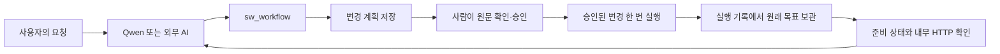

# AI에게 작은 웹 앱의 운영을 맡기기

기본 작업 흐름은 **alpha.10**부터 있어. 아래 기존 Service 확장과 `sw setup`은
**alpha.11**부터 제공해. 이전 버전의 파일을 자동으로 덮어쓰지 않으니 실행 경로를 확인해.
[처음 설치·인증·AI 연결](onboarding.md), [공개 버전 설치](install.md),
[기존 AI 연결](agent-mcp.md), [지원 범위](compatibility.md)를 함께 봐.
처음 실습하려면 [작은 시험 앱으로 AI 운영 체험](agent-workflow-trial.md)을 따라 해.

이 문서의 `sw connect`는 관리자 인증을 사용하는 기존 로컬 작업 방식이야.
개발 소스의 [서버 위임 작업](agent-operations.md)은 앱별 제한 토큰, 서버의 승인·실행 기록,
새 컨테이너 직접 검사를 추가해. 아직 공개 alpha.11에는 포함되지 않았어.
제한 토큰으로 AI에게 앱 운영을 맡기려면 새 안내를 사용해.

## 어떤 상황에 쓰나

서버 한 대에서 웹 앱 몇 개를 운영하면서, 배포·업데이트·장애 확인을 AI에게 맡기고 싶을 때야.
컨테이너 격리, 자동 재시작, 준비 상태 확인, 롤링 업데이트, 실행 기록을 제공해.
일반 Compose도 작은 서비스를 운영하는 좋은 선택이야. Shearwater는 선택한 앱의 운영 절차와
검증을 AI에게 전달하기 쉽게 묶는 데 집중해. Kubernetes의 전체 기능을 대체하지 않아.

AI 연결이 있다고 앱이 저절로 안전해지는 것은 아니야. 변경 전에 실제 계획을 확인하고,
승인한 변경만 적용하며, 성공 여부는 프로그램이 직접 관찰한 근거로 판단해야 해.

## AI와 프로그램이 나누어 하는 일

AI는 “업데이트하자”, “실패 원인을 살펴보자”라는 작업을 선택해. 앱의 정확한 신원,
승인 여부, 변경을 이미 실행했는지, 실제 접속이 되는지는 프로그램이 관리해.
대화를 새로 시작해도 사람이 긴 식별자나 이전 계획을 다시 옮겨 적지 않는 구조야.



| 말 | 쉬운 뜻 | 필요한 이유 |
| --- | --- | --- |
| 이미지 | 실행할 프로그램과 필요한 파일을 묶은 것 | 업데이트 때 어떤 프로그램을 실행할지 정해 |
| UID | 앱을 만들 때 붙인 고유 번호 | 같은 이름으로 다시 만든 다른 앱을 건드리지 않아 |
| 세대(generation) | 앱 설정을 바꿀 때 올라가는 번호 | 과거 버전의 정상 상태를 새 배포 성공으로 착각하지 않아 |
| 계획 해시 | 정확한 변경 원문을 식별하는 값 | 사람이 본 변경과 실행할 변경을 맞춰 |
| 실행 기록(receipt) | 쓰기를 시도했는지, 무엇이 적용됐는지 남긴 파일 | 대화가 끊겨도 적용을 무작정 반복하지 않아 |

복구도 이 경로의 새 계획이야. AI가 오류를 읽었다는 것, 복구 계획을 만들었다는 것,
실제로 다시 접속할 수 있다는 것은 서로 다른 단계로 표시해.

## 먼저 준비할 것

1. 실행 중인 Shearwater 서버와 일반 사용자에게 위임한 인증 디렉터리가 필요해.
   서버 설치와 인증 위임은 [MCP 안내](agent-mcp.md)를 따라. AI 대화를 root로 실행하지 마.
2. 이미 만들어진 컨테이너 이미지, 앱 이름, 컨테이너가 듣는 TCP 포트를 정해.
   이 기능은 소스에서 이미지를 빌드하거나 데이터베이스 변경을 자동 추론하지 않아.
3. 아래 예시는 컨테이너 하나·내부 Service 하나로 구성된 HTTP 웹 앱이야.
   공개 도메인·HTTPS 인증서·여러 컨테이너·데이터 이전은 별도로 준비해야 해.

### 기존 앱은 실제 연결 관계를 확인해 고정해

alpha.11은 현재 Deployment 이미지를 읽고, 그 앱의 라벨을 선택하는 Service를 찾아.
`app: 앱이름` 같은 라벨도 되고, 여러 라벨·앱과 다른 Service 이름·이름 붙은 targetPort도 돼.
한 개만 일치하면 자동으로 고르고, 여러 후보는 `--service=이름`, 여러 TCP 포트는
`--port=Service포트`로 명시해야 해. 연결 검사가 실패하면 작업 파일을 만들지 않아.

Service UID·IP·selector·선택한 포트를 저장하고, Pod의 ReplicaSet→Deployment 소유 UID와
EndpointSlice의 Service·Pod 신원도 확인해. 같은 라벨을 붙인 다른 앱이 섞이면 거부해.
계획 생성 전, 승인된 계획 실행 전, HTTP 검사 전후에 다시 확인하므로 이미 바뀐 경로를
알면서 이미지 변경을 진행하지 않아. 여러 API 요청이 하나의 원자적 트랜잭션은 아니므로
검사 직후 다른 관리자가 동시에 수정하는 것까지 차단하지는 않아. 적용 후에도 원래 목표와
경로를 다시 확인하며, 기존 앱의 라벨이나 Service를 바꿀 필요는 없어.

이전 alpha.10은 같은 이름의 Service·단일 포트·`app.kubernetes.io/name` 한 라벨만 허용해.
그 버전의 기존 작업 파일을 임의 편집하지 말고, 새 클라이언트로 새 작업 파일에 연결해.
`connected`는 신원과 경로를 기록했다는 뜻이고 `healthy`가 실제 내부 HTTP까지 통과한 상태야.

## 한 번만 연결하기

일반 Linux 사용자로 실행해. 경로와 이미지는 자신의 실제 값으로 바꿔.
작업 폴더는 그 사용자만 읽고 쓸 수 있어야 해.

alpha.11에서 기본 `sw setup`을 마쳤다면 기존 앱은 `sw connect --name=web`만으로 연결할 수
있어. 이미지·인증 경로·포트는 유일하게 확인되는 값만 사용하며, 기존 파일은 덮어쓰지 않아.
아래처럼 모두 명시하는 방식도 그대로 지원해.

```bash
sw connect --workflow=/absolute/private/web.json \
  --config-dir=/absolute/private/server-credentials \
  --listen=127.0.0.1:6443 \
  --name=web -n default --image=nginx:1.28-alpine --port=80 \
  --http-path=/ --expect-body='Welcome to nginx!'
```

이 명령은 연결을 검사하고 `web.json`과 그 옆 계획 폴더를 만들어. 서버를 교체하거나 앱을
배포하지 않아. 출력의 `mcpServers`를 사용하는 AI 클라이언트의 프로젝트 MCP 설정에 넣어.
이미 설정이 있다면 필요한 항목만 병합하고 전체 파일을 덮어쓰지 마. 자동으로 다른 앱의
전역 설정을 수정하지 않기 때문에 마지막 등록 방법은 클라이언트마다 달라.

핵심 MCP 실행 명령은 이것뿐이야. 접속 정보·앱 이름·UID를 매번 전달할 필요가 없어.

```bash
sw mcp --workflow=/absolute/private/web.json --allow-write
```

`--allow-write`는 계획과 승인된 실행 도구를 열어. 승인 자체를 만들지는 않아.
조회만 맡길 때는 이 옵션을 빼. `--workflow`와 예전 `--target` 또는 `--approved-plan`을
섞지 않아. 작업 파일이 연결 환경을 결정하므로 새 서버는 새 작업 파일로 명시적으로 연결해.

## 배포부터 접속 확인까지

AI에게 “연결된 앱을 배포해 줘. 먼저 상태를 확인하고 계획을 보여 줘”라고 말해.
AI는 `sw_workflow` 하나로 진행하고, `awaiting_approval`에서 멈춰야 해.

내장 대화는 이 상태와 실제 저장된 미승인 계획이 일치하면 모델 호출을 즉시 멈추고
계획을 사람에게 넘겨. 같은 모델 답변에 도구 호출이 여러 개 있어도 나머지를 실행하지 않아.
모델에게 “승인을 기다려”라고 부탁하는 것에만 의존하지 않는 구조야. 외부 MCP에는
`handoff: local_approval`을 함께 전달해. 외부 클라이언트가 대화를 멈추는 처리는 그
클라이언트의 책임이지만, 승인 없는 적용은 어느 연결에서도 거부해.

다음 두 명령은 사람이 같은 일반 사용자 터미널에서 실행해.

```bash
# 실제 이전 값·변경 후 값·경고를 읽는다. 이 명령은 승인하지 않는다.
sw workflow review --file=/absolute/private/web.json

# 원문을 확인한 계획의 정확한 해시를 넣는다.
sw workflow approve --file=/absolute/private/web.json --confirm=EXACT_PLAN_HASH
```

AI에게 “방금 계획을 승인했어. 끝까지 진행해 줘”라고 말해. 같은 연결의 `continue` 동작은
승인을 확인해 한 번만 적용하고, 제한 시간 동안 준비 상태와 실제 HTTP를 검사해.
더 기다려야 하면 `verify`를 호출해. alpha.11의 verify도 약 18초의 대기 예산으로 확인하고,
전체 도구 요청은 30초로 제한해. 기다리려고 적용을 반복하면 안 돼.

`healthy`가 되려면 다음 조건이 모두 필요해.

- 적용 응답에서 얻은 원래 앱 UID와 설정 세대가 여전히 같아야 해.
- 그 목표의 준비 상태가 만족되어야 해.
- 고정한 Service의 내부 주소로 직접 요청한 응답이 HTTP 200이어야 해.
- `--expect-body`를 지정했다면 그 문자열도 응답에 들어 있어야 해.

HTTP는 최대 64KiB 본문, 요청당 2초 제한이고 리다이렉트를 따라가지 않아. 인증 토큰이나
쿠키를 앱으로 보내지 않아. **내부 Service 접속 성공은 공개 주소 접속이나 로그인 성공을
뜻하지 않아.** 출력의 검사 범위를 확인해. 이전 Pod와 새 Pod가 함께 있는 전환 구간에는
Service가 어느 Pod로 요청을 보냈는지까지 입증하는 검사도 아니야.

## 업데이트와 장애 복구

빌드 결과를 파일로 전달하면 AI가 긴 이미지 digest를 다시 적을 필요가 없어.
예를 들어 빌드 도구가 아래 형태의 `release-image.json`을 만들도록 해. 실제로 빌드해
확정한 이미지 참조를 사용하고, 예시의 `EXACT_DIGEST`를 그대로 실행하지 마.

```json
{"image":"registry.example/web@sha256:EXACT_DIGEST"}
```

사람이나 승인된 빌드 절차가 이 파일을 선택해.

```bash
sw workflow stage-image --file=/absolute/private/web.json \
  --image-file=/absolute/build/release-image.json
```

처음 연결할 때는 `sw connect`에 `--update-image-file=/absolute/build/release-image.json`을
붙여도 돼. 프로그램이 파일의 값을 작업 파일에 복사해 고정하므로 원본 파일이 나중에
바뀌어도 선택한 이미지는 바뀌지 않아. 이 단계는 배포·계획 생성·승인이 아니야.
이미 계획이 대기 중이면 먼저 처리하거나 정확히 취소해야 새 이미지를 선택할 수 있어.
파일은 `image` 필드만 가진 4KiB 이하의 일반 파일이어야 하고 심볼릭 링크는 받지 않아.

이렇게 선택한 뒤 AI는 `{"action":"update"}`만 호출해. 다른 이미지 값을 붙이면
계획을 만들기 전에 거부해. 선택 파일을 사용하지 않는 기존 방식에서는 update의
`image` 인자로 새 이미지를 직접 지정할 수 있지만, 모델의 전사 오류 가능성이 남아 있어.

“이 앱을 새 이미지로 업데이트해 줘. 데이터와 다른 설정은 유지해”라고 요청해.
이미지 변경 계획은 기존 설정을 읽고 이미지 한 필드만 바꿔. 환경 변수·볼륨·준비 검사 등은
유지해. 새 계획을 검토·승인한 뒤 같은 연결에서 실행과 검증을 이어가.

문제가 생겼다면 “왜 배포가 안 되는지 확인하고 복구 계획까지 만들어 줘”라고 말해.
프로그램은 고정한 앱 UID의 ReplicaSet과 Pod 소유 관계를 따라 실제 오류를 읽어.
AI가 Pod 이름을 추측할 필요가 없어. 복구는 **이 작업에서 준비 상태와 HTTP까지 확인했던
이미지**로 돌아가는 새 계획이야. 정상 이미지 기록이 없으면 임의로 추측하지 않고 거부해.

이미지는 가능하면 `저장소@sha256:...` 형태의 고정 digest로 지정해. 일반 태그는 원격에서
내용이 바뀔 수 있어. 저장한 이미지 참조가 같다는 것과 이미지 내용이 영원히 같다는 것은 달라.

복구 역시 사람의 정확한 새 승인이 필요해. 컨테이너 이미지 복귀가 데이터베이스 마이그레이션을
되돌리는 것은 아니야. 앱 데이터가 바뀌는 배포는 별도 백업·복구 절차를 검토해야 해.

## Qwen 내장 대화와 외부 DeepSeek

Linux Ollama에 설치한 모델로 내장 대화를 시작할 수 있어.

```bash
sw chat --workflow=/absolute/private/web.json --allow-write --model=qwen2.5:latest
```

대화형 터미널에서는 `/review`와 `/approve`를 사용할 수 있어. 한 질문 모드라면 별도
터미널에서 위의 workflow 명령으로 승인하고, 같은 파일로 새 질문을 보내면 돼.

Windows Ollama 연결 도우미도 작업 파일을 전달해. 파일은 Windows 경로가 아닌 WSL 경로야.

```powershell
python chat-windows.py --sw /absolute/path/sw --model qwen2.5:latest `
  --workflow /absolute/private/web.json --allow-write `
  --prompt "연결된 앱의 상태를 확인해 줘"
```

외부 Claude·Codex·DeepSeek는 위 MCP 명령을 연결해 같은 도구를 사용해. DeepSeek 공식
명령줄 MCP와 실제 모델을 시험하되, 그래픽 앱 설정까지 자동으로 바뀐다고 가정하지 않아.
내장 대화의 `[Shearwater 확인 결과]`는 모델이 고쳐 쓴 문장이 아닌 실제 도구 결과야.
외부 클라이언트도 자동 판정에는 MCP `structuredContent`를 사용해.

## 중간에 끊기거나 잘못 선택했을 때

| 상태 | 의미와 다음 행동 |
| --- | --- |
| `not_deployed` | 선택한 앱이 아직 없음. deploy로 계획부터 만들어 |
| `awaiting_approval` | 계획만 저장했음. 원문을 보고 정확히 승인해 |
| `approved_pending` | 정확한 로컬 승인은 있지만 아직 실행 전. 같은 승인으로 continue를 호출해 |
| `not_met` / `unknown` | 준비 조건 미충족 또는 근거 부족. 진단하거나 verify로 다시 확인해 |
| `stale` | 원래 목표 세대가 바뀜. 최신 값을 원래 성공으로 대체하지 않아 |
| `http_failed` | 준비 상태와 실제 접속 결과가 다름. HTTP 검사 실패 이유를 봐 |
| `healthy` | 기록된 목표와 내부 HTTP 검사를 만족한 관측 결과 |
| uncertain/partial 오류 | 쓰기 응답이 불확실하거나 일부만 적용됨. 자동 재전송하지 말고 실행 기록을 조사해 |

연결 프로세스를 다시 시작해도 완료된 실행 기록이 있으면 그 기록에서 원래 목표를 복원해.
같은 이름으로 앱이나 Service를 다시 만든 경우에는 새 UID를 자동으로 채택하지 않아.
계획은 15분 뒤 만료돼. 미실행 계획을 취소하려면 `sw workflow discard --file=... --confirm=HASH`를
사용하고 새 계획을 만들어. 원본 계획과 승인 파일은 지우지 않지만 이 작업의 선택에서는 해제해.
이미 시도한 계획은 discard로 숨길 수 없어.

작업 파일과 인증을 가진 OS 사용자는 관리자 권한을 위임받은 상태야. 앱 고정과 도구 축소는
실수를 줄이는 클라이언트 실행 규칙이고, 서로 믿지 못하는 사용자 간의 서버 권한 분리는 아니야.

## 코드를 읽는 순서

1. `cmd/sw/workflow.go`의 `runConnect`: 입력과 서버 연결을 확인하고 작업 파일을 만들어.
2. `workflowTools`, `callWorkflow`: 모델이 선택할 작업과 인자를 제한해.
3. `workflowPlan`: 기존 계획 준비 기능을 재사용해 앱 범위 안에서 변경을 저장해.
4. `workflowContinue`, `consumeReceipt`: 정확한 승인과 단 한 번의 실행 기록을 확인해.
5. `workflowVerify`, `workflowProbe`: 원래 목표와 실제 접속을 구분해서 검사해.
6. `cmd/sw/workflow_test.go`: 미승인 적용, 잘못된 UID, 불확실한 응답, HTTP 경계를 재현해.
7. `cmd/sw/workflow_image.go`와 대응 테스트: 빌드 결과를 한 번 읽고 정확한 이미지로 고정해.
8. `cmd/sw/chat.go`, `workflowNeedsApproval`: 실제 승인 대기에서 모델 실행을 멈춰.
   `hack/workflow-check.py`는 반복하려는 모의 모델로 이 경계까지 실제 명령을 검사해.

새 상주 서비스나 모델 실행기를 서버에 추가하지 않아. 작업 파일은 작고, 실제 모델 호출은
사용자가 대화를 실행할 때만 이루어져. Kubernetes 호환 기능을 삭제한 것과는 구분해야 해.
