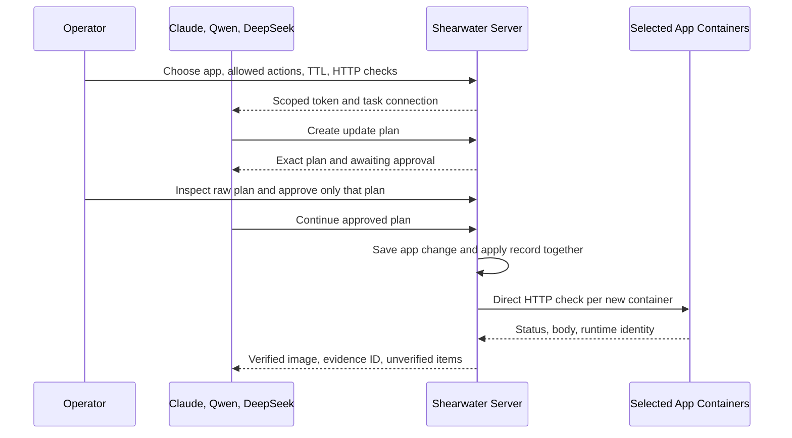

# Delegating Single-App Operations to an AI

*Translated from the [Korean original](../agent-operations.md). If they differ, the Korean version is current.*

This document describes the server task feature **available from alpha.12**. `sw task` does not exist in alpha.11.
Follow the examples in the [installation guide](install.md) to set up both the server and the client at alpha.14.
The implementation is in [internal/operation](../../internal/operation), and the command wiring is in [cmd/sw/operation.go](../../cmd/sw/operation.go).

## What Changes

The user asks: "Update this app and verify that it is actually healthy." The AI picks the action and explains the result. The Shearwater server manages **which app is targeted, which actions are allowed, which change was approved, whether it was already applied, and whether the new containers actually responded**.

The local workflow file from `sw connect` still works. In that mode, a client with admin credentials enforces app selection and approval steps. The new `sw task` flow issues a separate token scoped to one app and enforces the restrictions on the server. Even if someone edits the workflow file or calls hidden HTTP endpoints directly, that token cannot access other apps, raw Kubernetes APIs, or approval and permission-issuing endpoints.



| Term | Plain Meaning |
| --- | --- |
| Task ID | Identifier for a delegation record on one app. It stays the same even if you switch models. |
| UID | Unique ID assigned when an app is created. Recreating an app with the same name produces a different app. |
| Delegated token | Secret that can perform only the allowed actions for this task until its expiration time. |
| Plan hash | Identifier for the exact change a human reviewed. Approval for one change cannot be reused for another. |
| Generation | Version number of the app spec. A healthy state from an older spec does not count as success for a new rollout. |
| Image digest | Immutable fingerprint of image contents. A tag name can change in a remote registry. |
| Evidence ID | Identifier used to look up the actual HTTP check record. Lets you review it without sending full response bodies to the AI. |

## Initial Setup

See [Initial Setup and Authentication](../onboarding.md) first to set up the server and admin credentials for a regular user.
You need a container image that is ready to run. This feature does not automatically prepare image builds, registries, public domains, HTTPS, or database migrations. It targets a small, trusted HTTP app on a single server.

Run these commands in an **operator terminal with admin credentials**. Replace the paths, names, and image below with your real values. `--out` must be an absolute path that does not exist yet. Existing credentials are not overwritten.

```bash
# Existing app: a uniquely matching Service and TCP port are found automatically.
sw task create --name=web -n default \
  --allow=update,recover --ttl=1h \
  --http-path=/health --expect-body=ok \
  --out="$HOME/.local/state/shearwater/agents/web"

# New app: the operator chooses the name, initial image, and port.
sw task create --name=demo -n default \
  --image=YOUR_REGISTRY/demo@sha256:YOUR_ACTUAL_DIGEST --port=8080 \
  --allow=deploy,update,recover --ttl=1h \
  --out="$HOME/.local/state/shearwater/agents/demo"
```

Omitting `--allow` grants read-only access. Choose allowed actions from `deploy`, `update`, and `recover`. The maximum TTL is 24 hours. If an existing app has multiple Services or TCP ports, pass `--service=NAME --port=SERVICE_PORT` explicitly. Named `targetPort` values are also supported. Pods selected by the Service must actually belong to that app's ReplicaSet.

The output prints the task ID, connection file path, and MCP config. The new directory contains only the public CA certificate, `delegated.token`, and `work.json`. Admin tokens are not copied. The raw token is not written to stdout or the server DB; the server stores only a verification hash.

To target a different server instead of the default credentials, pass `--config-dir=/operator/auth --listen=127.0.0.1:PORT`. Do not give this admin credentials directory to the AI.

## Sharing One Task Across Claude, Qwen, and DeepSeek

Start the existing MCP server or built-in chat with the generated `work.json`. The AI does not need to re-enter the app name, UID, or port. Only the single `sw_workflow` tool and its allowed actions appear in the tool list.

```bash
sw mcp --workflow=/absolute/agent/web/work.json --allow-write

sw chat --workflow=/absolute/agent/web/work.json --allow-write --model=qwen2.5:latest

# Print MCP config only. Does not overwrite the AI app's global config.
sw workflow mcp-config --file=/absolute/agent/web/work.json --platform=linux
sw workflow mcp-config --file=/absolute/agent/web/work.json --platform=windows
```

For Windows config generation, run the command as a regular user inside the WSL distribution you intend to use. The printed command explicitly names that WSL distribution and regular user. `--allow-write` is only a client-side option that exposes planning and execution tools; it does not widen server-issued permissions or approve plans. Omit it for read-only delegation.

When starting a new chat or switching models, point to the same connection file and say: "Check the current task and continue." The server stores the progress state, so you do not need a long recap of earlier chats. If two clients run at the same time, only one plan can be active. Calling the same plan multiple times does not re-apply a change that was already applied, and a different new plan will not run as a retry of an older plan.

The built-in `sw chat` ends the turn programmatically once real HTTP verification finishes for an approved `continue`. Even if the model repeats the request or includes another change in the same reply, it is not executed. A plain `verify` may be a pre-update check, so a healthy current app does not terminate a new update request. External MCP apps manage their own turn-ending policy, but the server rule against re-applying the same plan still holds.

## Reviewing and Approving Plans

When you ask the AI to "create a plan," the server saves the plan and returns `awaiting_approval`. The AI connection has no approval tool. Use the printed task ID and plan hash in the operator terminal.

```bash
sw task review --id=OPERATION_ID
sw task approve --id=OPERATION_ID --confirm=EXACT_PLAN_HASH
```

The plan includes the before and after images, target UID and generation, HTTP check criteria, and expiration time. Environment variable values and the full app spec are not exposed to the AI. Instead, the server binds a fingerprint of the configuration and compares it with the current state right before applying. If another admin changed the app or Service route in the meantime, execution is rejected.

After approval, tell the AI: "Continue the approved plan." Only that stored plan is applied. For updates, the server changes only the image and one Pod template annotation that identifies the new rollout, while preserving existing environment variables, volumes, readiness probes, and other fields. For new apps, it creates a fixed single-container Deployment and an internal Service. There is no creation API that accepts arbitrary shell commands, `hostPath`, environment variables, or raw manifests from a model.

A plan stays valid for 15 minutes or until the delegation expires, whichever comes first. An operator can clear a mistaken unapplied plan with `sw task discard --id=ID --confirm=HASH`. Past records remain in history. A single task can hold at most 32 plans. When it fills up, keep the record and create a new delegation.

## Pinning Build Outputs and Check Criteria

Instead of making the model retype long image references, the operator can point to a build output file. It is a small plain JSON file of the form `{"image":"ACTUAL_IMAGE@sha256:ACTUAL_DIGEST"}`.

```bash
sw task stage-image --id=OPERATION_ID --image-file=/absolute/build/image.json
```

After staging, the AI only needs to choose `update`. If it sends an image value explicitly, it must match the staged value. Staging is neither approval nor deployment. The actual plan must still be created, reviewed, and approved separately. During deploy and recover as well, repeating the server-selected image reference is accepted, while changing it to another image is rejected. This convenience does not widen approval or permission scope.

`stagedImage` is the **image prepared for an upcoming change**, and `verifiedImage` is the **current image verified with live HTTP checks**. If they differ, an update request is not done even if the current app is `healthy`. The next-action hint in the server response also guides the client to create a plan. When the image for a new app or update is already fixed, the model only needs to select the action, such as `{"action":"deploy"}` or `{"action":"update"}`. Even when an update-capable connection exposes an optional `image` input, the server rejects any value that differs from the pinned one. The action list matches the delegated permissions and stays fixed for the life of the connection, so AI apps that keep the initial tool list can proceed from deploy to update or recover.

To define checks for the new version, write up to four checks in a JSON file with `0600` permissions. Each check can specify an internal server path and a substring that must appear in the response.

```json
[
  {"path":"/health", "contains":"ok"},
  {"path":"/version", "contains":"release-2026-11-18"}
]
```

Adding `--checks-file=/absolute/private/checks.json` to `stage-image` pins the checks to the plan along with the new image. The initial `create` command supports the same flag. These checks only use HTTP GET, so they do not replace end-to-end tests for login, payments, or write operations. Do not put secrets in the expected strings.

## What Counts as Verified

`healthy` means all of the following were confirmed for the same task target:

1. The app UID and target generation, plus the Service UID, address, selector, and port, match the selected values.
2. The desired number of Ready Pods exist in the new ReplicaSet carrying the target Pod template.
3. All Ready endpoints of the selected Service point to those new Pods. If older Pods are still mixed in, the check waits.
4. Direct requests to each new Pod's IP return HTTP 200 and the expected substring for every check.
5. The same checks pass against the fixed Service address.
6. After the HTTP requests complete, the app, route, Pod, and running container identities still match. If anything changed during verification, observation runs again.

Responses from a previous version do not count as success. Digest-pinned images are also compared against the running container's `ImageID`. For tag-based images, the running container is still checked, but there is no guarantee the tag will keep pointing to the same content later. The result records this distinction in `imageContentPinned`.

Network checks connect only to managed Pod and Service IPs and do not use environment proxies, DNS, or redirects. No auth tokens or cookies are sent to the app. Each request is limited to 2 seconds and a 64KiB body. Server observation is neither a guarantee of future uptime nor verification of public URLs, TLS, login flows, or database migrations.

The server returns a small summary to the AI: status, facts, unverified items, next action, and evidence ID. Full response bodies, environment variables, and long logs are not sent. Operators can inspect the detailed record directly.

```bash
sw task evidence --id=OPERATION_ID
```

The latest record includes the check timestamp, Pod/container/image identities, paths, HTTP status codes, and body sizes and hashes. Its ID must match the evidence ID returned to the AI. Later verifications can overwrite the latest record, so save the output to a separate file if you need long-term auditing. Do not use the model's natural-language explanation itself as execution proof.

## Handling Failures and Interruptions

If an image is missing and containers fail to start, `diagnose` shows the actual waiting reason, restart count, and related details for owned Pods. It separates observed errors from inferred root causes. If you ask the AI to "diagnose and create a recovery plan," it can inspect the failure and use `recover` to create a new plan for the last healthy image.

The recovery image is the **exact runtime digest that previously passed both direct Pod and Service checks**. The new plan still requires a new approval. Rolling back an image does not undo database migrations or data the app has already written. You must trust the approved image itself, and data changes require separate backup procedures.

The app change and the apply record are saved in the same SQLite transaction. Even if the response is lost right after the server saves the change, the record remains. The next `continue` call reads the existing plan's apply record and checks readiness. A DB commit does not mean the app is already running. The node agent and controller start the actual containers, and completion requires live HTTP checks afterward.
If another plan is created between apply and verification, the server does not attach the new plan's success evidence to the earlier request; it returns `superseded`, meaning you must re-read the current state.
While the client waits for readiness, it keeps the originally applied plan ID and approval record, repeating only `verify`. The built-in chat stops as complete only after HTTP verification finishes for that same app generation and plan; if another plan intervenes, it is not reported as success for the earlier plan.

If a token expires or you need to issue a fresh connection file, the operator creates a new directory to take over.

```bash
sw task resume --id=OPERATION_ID --ttl=1h --out=/absolute/new-agent-connection
sw task revoke --id=OPERATION_ID
```

`resume` keeps the same task and permission scope, issues a new token, and invalidates the old one.
`revoke` rejects all subsequent requests using the current token. It does not cancel an already committed deployment.
If you rotate a token shared by multiple AI clients, all of them must switch to the new connection.

## Permission Boundaries and Current Limitations

- Calling server APIs directly with a scoped token still blocks access to other apps, raw resources, and self-approval.
  However, if the AI can read admin credential files or run a root shell through another tool, that separate access is not restricted here. Separate OS accounts and file permissions between the operator and the agent, or connect through a client that exposes only this MCP server, as in testing.
- This is not a product for safely isolating containers from mutually untrusted users on the same host.
  Its scope is image deployment, inspection, and approved recovery for trusted apps.
- Supported targets are one container in a single Deployment, 1–16 replicas, an internal TCP Service, and 1–4 GET checks.
  Stopped apps, multi-container workloads, and arbitrary scaling are not included in this delegation API.
- No new always-on AI service is added. Models are called on demand from the client.
  The server adds only a small task store and verification logic. See the [verification results](../agent-operations-verification.md) for measured memory, token, and time costs along with test conditions.

## Reading Order for the Code

1. `cmd/sw/operation.go`: operator commands, scoped credential files, and integration with the existing MCP server and built-in chat.
2. `internal/api/operation.go`: request-path separation between admin and scoped tokens, plus strict input validation.
3. `internal/operation/manager.go`: delegation, approval, planning, execution, and resume. Permission enforcement lives here.
4. `internal/store/operations.go`: where task records and app changes are stored in the same transaction.
5. `internal/operation/route.go`: verifies actual ownership from the Service down to the app's Pods.
6. `internal/operation/verify.go`: direct HTTP checks against new Pods, Service checks, and post-request identity re-verification.
7. Each `_test.go`: reproduces lost responses, concurrent calls, expiration, revocation, stale plans, and responses from old Pods.
