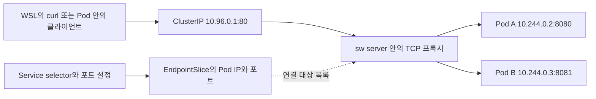

> 공개 준비 과정에서 개인 경로·내부 세션 식별자·로컬 앱 이름을 일반화했어. 측정값과 당시 검증 범위는 유지했고, `<private-evidence>`는 공개 저장소에 없는 원본 기록을 뜻해.

# Shearwater에서 Service가 Pod에 연결되는 과정

> **버전 구분:** 아래의 프로세스 내부 TCP 프록시 설명과 정지 시 연결 종료는 공개 alpha.4까지의 동작이야. alpha.5는 Linux 커널 전달과 롤링 연결 종료 대기를 사용해. alpha.5 방식의 설정·실패 경계·시험 방법은 [연결 유지와 롤링 종료 대기](connection-continuity.md)를 먼저 봐. 아래 문서는 M5 도입 당시의 배경과 API 사용 예를 함께 보존하고 있어.

Pod는 앱 컨테이너가 실행되는 단위야. Pod를 삭제하고 다시 만들면 이름이나 IP가 바뀔 수 있어. **Service는 클라이언트가 계속 사용할 주소와 포트**를 제공해. 여기서 주소를 **ClusterIP**라고 불러. 예를 들어 클라이언트는 `10.96.0.1:80`에 연결하고, Shearwater가 그 연결을 현재 준비된 Pod의 `10.244.0.2:8080`으로 전달해.

EndpointSlice는 Service 뒤에 있는 Pod 주소와 포트의 목록이야. **TCP 프록시**는 목록을 읽어 실제 연결을 만드는 부분이야. Service, EndpointSlice, 프록시는 각각 접속 주소, 연결할 대상, 연결 전달을 맡아. [Kubernetes Service](https://kubernetes.io/docs/concepts/services-networking/service/) · [EndpointSlice](https://kubernetes.io/docs/concepts/services-networking/endpoint-slices/)



## 한 번 직접 연결해 보기

아래 예제는 WSL의 `kubectl`이 실행 중인 Shearwater를 가리킨다고 가정해. `kubectl config current-context`로 대상을 확인하고 `kubectl get nodes`에서 Shearwater 노드가 Ready인지 확인해. 서버를 따로 준비하지 않고 체험하려면 이 문서 마지막의 통합 스크립트를 실행하면 돼. 스크립트가 검증용 서버와 kubeconfig를 만든다.

Service를 먼저 만든 뒤 Pod를 만든다. Service의 `selector`와 Pod의 `labels`가 일치하는지 봐. `port: 80`은 클라이언트가 접속할 포트야. `targetPort: web`은 선택된 Pod에서 이름이 `web`인 컨테이너 포트를 찾아 쓰라는 뜻이고, 이 예제에서는 8080이야.

```bash
kubectl create -f - <<'YAML'
apiVersion: v1
kind: Service
metadata:
  name: demo-web
spec:
  selector:
    app: demo-web
  ports:
    - name: http
      port: 80
      targetPort: web
---
apiVersion: v1
kind: Pod
metadata:
  name: demo-web
  labels:
    app: demo-web
spec:
  containers:
    - name: app
      image: busybox:1.36
      ports:
        - name: web
          containerPort: 8080
      command:
        - sh
        - -ec
        - |
          mkdir -p /www
          echo 'hello from demo-web' > /www/index.html
          echo "Service address: $DEMO_WEB_SERVICE_HOST:$DEMO_WEB_SERVICE_PORT"
          exec httpd -f -p 8080 -h /www
YAML

kubectl wait --for=condition=Ready pod/demo-web --timeout=60s
kubectl get service demo-web
kubectl get endpointslices -l kubernetes.io/service-name=demo-web -o wide
demo_ip=$(kubectl get service demo-web -o jsonpath='{.spec.clusterIP}')
curl --noproxy '*' --max-time 5 "http://$demo_ip/"
kubectl logs demo-web
```

예상 응답은 `hello from demo-web`이야. Pod가 Ready가 된 직후에는 EndpointSlice와 프록시가 변경을 읽는 데 잠깐 걸릴 수 있어. `kubectl get endpointslices`에 Pod 주소가 보인 뒤 `curl`을 다시 실행하면 돼. `containerPort`는 포트 이름과 번호를 알려 주는 선언이야. 실제로 8080에서 연결을 받는 건 예제의 `httpd`야. 이 예제에는 `readinessProbe`가 없어서 컨테이너가 실행되면 Ready가 될 수 있고, 앱이 포트를 열 때까지 접속이 실패할 수도 있어. alpha.4부터는 [readiness 검사](health-probes.md)를 실행해. 실제 앱에는 준비 상태를 확인하는 검사를 넣어 앱이 요청을 받을 수 있을 때 Service 대상으로 들어가게 해.

예제가 끝나면 그때 만든 두 객체를 지워.

```bash
kubectl delete service demo-web
kubectl delete pod demo-web
```

## ClusterIP가 유지되는 이유

일반 Service를 만들 때 `spec.clusterIP`를 비워 두면 `10.96.0.0/16`에서 빈 IPv4 주소를 하나 고른다. 자동 할당은 대역의 처음과 마지막 주소를 건너뛴다. 주소를 직접 지정해도 돼. 이미 다른 Service가 쓰는 주소는 요청에 오류로 응답해. Service가 존재하는 동안 ClusterIP는 고정돼.

API는 Service 객체와 주소의 예약을 같은 SQLite 트랜잭션에 저장해. 트랜잭션은 관련 변경을 한꺼번에 확정하거나 모두 되돌리는 단위야. 그래서 생성 요청이 실패하거나 서버 dry-run이면 주소도 실제로 소비되지 않아. 예약은 Service 이름이 아니라 객체의 고유 ID인 UID에 묶인다. Finalizer 때문에 삭제가 대기 중이면 예약도 남고, 객체가 실제로 지워질 때 주소를 반납한다.

M4에서 넘어온 데이터베이스는 서버 시작 시 보정돼. 지정해 둔 주소를 먼저 예약하고, 주소가 비어 있던 Service에 빈 주소를 할당한다. M4는 중복 지정이 가능했으므로, 같은 주소를 지정해 둔 Service가 둘 있으면 시작 로그에 두 객체가 표시되고 업그레이드 트랜잭션이 취소된다. 이런 데이터베이스는 기존 M4 바이너리에서 중복 Service를 정리한 뒤 M5로 다시 열어야 해.

## EndpointSlice가 연결할 Pod를 고르는 기준

같은 네임스페이스 안에서 Service selector의 모든 키와 값이 Pod 라벨에 맞아야 해. Pod에 유효한 Pod IP가 있고, Ready 조건이 True이며, 삭제가 시작되지 않았을 때 연결 대상으로 넣는다. alpha.4에서는 `readinessProbe`가 있으면 그 검사 결과를 Ready에 반영해. 검사가 없으면 컨테이너 실행 상태만으로 Ready가 될 수 있으므로, Ready 표시만 보고 앱 포트까지 검증됐다고 생각하면 안 돼.

숫자 `targetPort: 8080`은 해당 번호를 그대로 사용해. 이름 `targetPort: web`은 Pod의 컨테이너 포트 선언에서 이름과 TCP가 맞는 항목을 찾는다. 예를 들어 Pod A의 `web`은 8080, Pod B의 `web`은 8081일 수 있어. EndpointSlice의 `ports`는 그 Slice에 속한 모든 주소에 공통으로 적용돼. 그래서 Shearwater는 이렇게 숫자가 다르면 포트 조합별로 Slice를 만든다. Pod가 이름을 선언하지 않았다면 그 포트의 대상에서는 빠지고, 같은 Service의 다른 포트는 연결 대상으로 남을 수 있어. [EndpointSlice의 포트와 분할](https://kubernetes.io/docs/concepts/services-networking/endpoint-slices/#distribution-of-endpointslices)

Service를 고치는 동안 이전 EndpointSlice가 잠깐 남아 있을 수 있어. 프록시는 Slice의 Service UID와 Service generation을 현재 객체와 대조한다. UID는 같은 이름을 다시 써도 달라지고, generation은 Service 명세를 바꿀 때 증가해. 이 둘을 확인하면 예전 selector나 포트로 만든 Slice를 새 설정에 사용할 수 없어.

프록시가 Pod로 연결하기 전과 직후에는 현재 Pod의 UID, 라벨, Ready, IP를 다시 확인해. 이때 `status.podIP`에 적힌 값과 SQLite에서 그 Pod UID에 실제로 예약된 주소가 모두 맞아야 해. Pod가 종료됐거나 그 IP를 다른 Pod가 받았다면 이전 목록을 건너뛰어. 컨테이너 하나가 죽고 다른 컨테이너는 연결을 받을 수 있는 경우도 있어. 노드 에이전트는 종료를 발견하면 교체 이미지를 받기 전에 Ready를 내려 새 연결에서 그 Pod를 빼.

## TCP 프록시가 연결을 전달하는 방식

Linux에 있는 `sw-svc0` 더미 인터페이스에 ClusterIP를 `/32`로 붙인다. 더미 인터페이스는 물리 장치 없이 로컬 주소를 둘 수 있는 장치야. `/32`는 IPv4 주소 하나만 의미해. 주소를 붙인 뒤 `sw server`가 `ClusterIP:port`에서 TCP 연결을 받는다.

호스트에 그 IP가 이미 있거나 VPN 등에서 그 주소를 포함하는 경로를 쓰면, 그 Service는 SQLite에 남지만 충돌한 IP에 리스너를 열지 않아. 커널에 로컬 주소를 붙이면 원래 그 경로로 가던 트래픽까지 가져오기 때문이야. 실행 중에도 주기적으로 다시 확인하고 충돌을 발견하면 Shearwater가 붙인 `/32`만 떼. 다른 IP의 Service는 계속 연결할 수 있어.

프록시가 Pod로 연결을 열 때는 호스트의 Pod 브리지인 `sw-br0`을 지난다. 새 Pod가 이전 Pod의 IP를 받으면 가상 네트워크 장치의 MAC 주소는 달라질 수 있어. 새 장치를 브리지에 붙일 때 그 Pod IP에 대한 이전 MAC 기록만 지워서, 다음 연결이 새 장치를 바로 찾게 한다.

새 TCP 연결마다 준비된 주소를 돌아가며 첫 후보로 선택한다. 첫 후보에 TCP 연결을 열 수 없으면 남은 후보를 시도한다. 연결을 맺은 뒤에는 앱의 바이트를 양방향으로 복사하므로, 이미 전달을 시작한 요청을 다른 Pod로 다시 보내지 않아. HTTP keep-alive처럼 여러 요청을 하나의 TCP 연결에 보내면 그 연결은 같은 Pod로 간다. TCP에서 한쪽이 쓰기를 끝내도 반대 방향의 응답이 끝날 때까지 읽을 수 있다. [Go TCPConn.CloseWrite](https://pkg.go.dev/net#TCPConn.CloseWrite)

Service를 삭제하거나 포트를 없애면 해당 리스너와 연결을 닫는다. 주소를 사용하는 Service가 없어지면 인터페이스에서 그 주소를 뗀다. 서버를 정상 종료하면 연결을 닫고 주소는 남겨 둔다. 다시 실행하면 SQLite의 설정을 읽어 필요한 주소와 리스너를 맞추고, 남아 있는 불필요한 ClusterIP를 정리한다.

### 롤링 교체와 서버 재시작 때 연결은 어떻게 될까

**Service 주소가 유지되는 것과 기존 TCP 연결이 유지되는 것은 달라.** HTTP keep-alive는 여러 HTTP 요청에 연결 하나를 다시 쓰는 방식이야. 그 연결의 상대 Pod가 종료되면 연결도 끝날 수 있어. 프록시는 이미 보낸 바이트를 새 Pod에서 이어서 처리하지 않아.

`maxUnavailable: 0`은 롤링 교체 중 준비된 Pod 수를 관리하는 설정이야. 모든 HTTP 요청이 성공한다거나 기존 연결을 다른 Pod로 옮겨 준다는 뜻은 아니야. 삭제가 시작된 Pod는 새 연결 대상에서 빠지지만, 그 Pod에 이미 붙어 있던 연결까지 새 Pod로 이동하지는 않아. Pod의 종료 유예 시간도 앱이 종료될 때까지 기다리는 상한이지, 그 시간 동안 연결이 반드시 유지된다는 보장은 아니야.

`sw down` 뒤 `sw up`으로 서버만 재시작하면 기존 앱 컨테이너를 이어받을 수 있어. 하지만 Service TCP 프록시는 `sw server` 안에서 실행되므로 재시작 때 기존 프록시 연결은 닫혀. 클라이언트는 새 연결을 열어야 해. HTTP 클라이언트의 재연결·재시도 동작에 따라 사용자가 보는 결과도 달라질 수 있어.

요청 실패 뒤에는 서버가 그 요청을 처리했는지 알 수 없는 경우도 있어. 조회와 데이터 변경 요청을 구분하고, 특히 데이터 변경을 무조건 다시 보내서 같은 작업을 두 번 실행하지 않게 해야 해. 무중단이 필요한 앱은 요청별 오류와 기존 연결을 재사용하는 상황까지 포함해서 자기 클라이언트로 검증해.

## Pod 안에서 Service 주소를 찾는 방법

Pod의 첫 컨테이너 실행을 시도하기 직전에 같은 네임스페이스의 Service 목록을 읽어서 환경변수 값을 정해. Service 이름을 대문자로 바꾸고 하이픈을 밑줄로 바꾸기 때문에 `demo-web`은 `DEMO_WEB`이 돼.

| 변수 | 예제 값 | 뜻 |
|---|---|---|
| `DEMO_WEB_SERVICE_HOST` | `10.96.0.1` | 할당된 ClusterIP |
| `DEMO_WEB_SERVICE_PORT` | `80` | Service에 선언한 첫 번째 포트 |
| `DEMO_WEB_SERVICE_PORT_HTTP` | `80` | 이름이 `http`인 Service 포트 |

이 값은 Pod UID별로 `pods/<uid>/service-env.json`에 한 번 저장한다. 첫 실행이 실패해 재시도하거나 같은 Pod의 컨테이너가 재시작해도 그 값을 사용해. 나중에 만든 Service나 바뀐 포트는 새 Pod부터 반영돼. Service를 지우면 그 주소를 새 Service가 받을 수 있어서, 기존 Pod의 환경변수가 예전 이름으로 남아 있어도 같은 Service라는 뜻은 아니야. 컨테이너 명세에 같은 이름의 `env`를 직접 지정하면 그 값이 우선이야.

## 연결이 안 될 때 확인할 순서

1. **Service 주소와 포트부터 확인한다.** `kubectl get svc demo-web -o yaml`에서 `spec.clusterIP`, `port`, `targetPort`를 확인해. `curl`에는 Service의 `port`를 넣어.
2. **Pod가 선택되는지 확인한다.** `kubectl get pod -l app=demo-web -o wide`로 Pod IP와 Ready 상태를 확인해. `kubectl get endpointslices -l kubernetes.io/service-name=demo-web -o yaml`의 `endpoints`와 `ports`를 같이 봐. 주소가 있어도 원하는 이름의 포트가 빠져 있다면 Pod의 포트 선언을 확인해.
3. **Pod 자체에 연결한다.** WSL에서 `curl --noproxy '*' http://<Pod-IP>:<target-port>/`를 실행해. 이 연결이 실패하면 앱이 실제로 그 포트를 열었는지 `kubectl logs <pod>`로 확인해.
4. **ClusterIP가 WSL에 붙었는지 확인한다.** `ip -o -4 addr show dev sw-svc0`에 ClusterIP의 `/32`가 있어야 해. 공개 alpha.4는 `ss -ltn`으로 Service 리스너를 확인해. alpha.5에는 이 리스너가 없고, root로 `iptables -t nat -S SHEARWATER-SERVICES`를 읽어 전달 대상을 확인해. 로그에 `overlaps host route`가 있다면 `ip -4 route show table all`로 어떤 대역이 겹치는지 확인해.
5. **환경변수가 비어 있다면 시작 순서를 확인한다.** Service를 만들고 Pod를 새로 생성하면 새 Pod가 주소를 읽어. 실행 중인 컨테이너는 시작할 때 받은 환경을 유지해.

이 단계는 IPv4 ClusterIP와 TCP를 지원해. Selector가 없는 Service는 주소를 예약하지만 Shearwater가 자동 연결 대상을 채우지 않아. `clusterIP: None`은 저장되며 주소나 리스너가 생기지 않아. UDP, NodePort, LoadBalancer, Service 이름을 푸는 DNS는 이후 단계 범위야. WSL에서의 접근과 Pod에서의 접근을 검증 대상으로 삼았어.

`sw server --runtime=none`에서는 API를 통해 Service를 만들고 IP를 예약할 수 있어. 실제 Pod, EndpointSlice 자동 조정, TCP 리스너까지 보려면 containerd 모드로 실행해야 해.

## 코드 읽기와 테스트 재현

| 읽을 곳 | 확인할 내용 |
|---|---|
| `internal/api/serviceip.go`, `internal/store/store.go` | 주소 예약과 Service 생성이 같은 트랜잭션에서 처리되는 이유 |
| `internal/controller/endpoints.go` | selector와 Ready를 검사하고 이름 포트를 숫자로 바꾸는 흐름 |
| `internal/runtime/serviceip_linux.go` | 커널에서 더미 인터페이스와 개별 주소를 맞추는 흐름 |
| `internal/runtime/network_linux.go` | Pod IP를 재사용할 때 브리지의 이전 MAC 기록을 비우는 흐름 |
| `internal/proxy/routes.go`, `internal/proxy/forward.go` | alpha.4의 Slice 후보 선택과 프로세스 내부 TCP 복사 방식; 기존 단위 테스트도 유지 |
| `internal/proxy/kernel.go`, `internal/runtime/services_linux.go` | alpha.5의 UID/IP 예약 검증과 커널 전달 규칙 |
| `internal/drain/drain.go`, `internal/runtime/serviceconn_linux.go` | 연결 종료 대기의 확인과 conntrack 집계·정리 |
| `internal/node/serviceenv.go` | Pod 시작 시 환경변수 값을 저장하는 이유 |

자동 검증은 WSL Ubuntu-24.04에서 실행해. 먼저 일반 사용자로 바이너리를 빌드한 뒤, PowerShell에서 테스트만 root로 실행하면 돼. 아래 두 번째 명령의 `<절대 경로>`는 WSL 경로로 바꿔.

```bash
cd $SOURCE_DIR
. hack/env.sh
mkdir -p "$HOME/.cache/shearwater-dev/m5"
go build -o "$HOME/.cache/shearwater-dev/m5/sw" ./cmd/sw
```

```powershell
wsl.exe -d Ubuntu-24.04 -u root -- bash $SOURCE_DIR/hack/m5-check.sh <sw의-WSL-절대-경로> <kubectl의-WSL-절대-경로>
```

스크립트는 `/var/lib/shearwater/check/m5.*`에 격리된 DB, 서버 로그, API 요청 기록을 남겨. 종료 직전 스크립트가 만든 Service와 Pod를 지우고 서버를 멈춘다. 실제 실행 결과는 [HANDOFF.md](HANDOFF.md)의 M5 실측에서 확인할 수 있어.

호스트 경로 충돌만 따로 검증하려면 일반 사용자로 `. hack/env.sh` 뒤 `go test -c -o "$HOME/.cache/shearwater-dev/m5/runtime.test" ./internal/runtime`를 실행해. WSL의 root에서 아래 명령을 실행하면 테스트가 자기만의 네트워크 네임스페이스를 만들고 그 안에서만 더미 인터페이스와 충돌 경로를 만든다. 테스트가 끝나면 그 네임스페이스도 사라져.

```powershell
wsl.exe -d Ubuntu-24.04 -u root -- env SW_TEST_SERVICE_NETNS=1 <runtime.test의-WSL-절대-경로> -test.run ^TestServiceAddressesProtectHostRoutes$ -test.v
```
